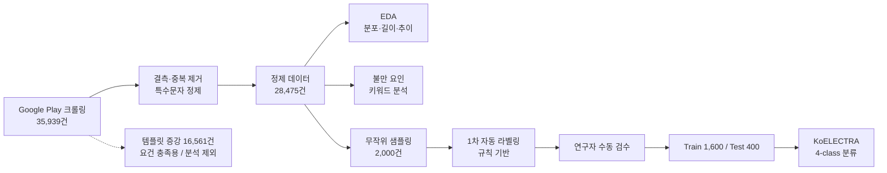

# 💔 데이팅 앱 사용자 리뷰 감성 분류 및 불만 요인 분석

> **"데이팅 앱 유저를 화나게 만드는 것은 '매칭'이 아니라 '돈'과 '불신'이다."**
>
> 글램(Glam)·틴더(Tinder)·탄탄(Tantan) 3개 데이팅 앱의 Google Play 리뷰를 수집·정제하여, 사용자가 **무엇 때문에 1점을 주는지**를 데이터로 진단하고, 리뷰를 **긍정 / 부정 / 중립 / 관계없음** 4개 클래스로 자동 분류하는 KoELECTRA 기반 문장 분류 파이프라인을 구축한 프로젝트입니다.

<br>

## 📑 목차

1. [프로젝트 개요](#1-프로젝트-개요)
2. [데이터셋](#2-데이터셋)
3. [전체 파이프라인](#3-전체-파이프라인)
4. [데이터 전처리 및 정제](#4-데이터-전처리-및-정제)
5. [탐색적 데이터 분석 (EDA)](#5-탐색적-데이터-분석-eda)
6. [불만 요인 분석: 사람들은 무엇 때문에 1점을 주는가](#6-불만-요인-분석-사람들은-무엇-때문에-1점을-주는가)
7. [데이터 라벨링](#7-데이터-라벨링)
8. [모델 학습: KoELECTRA 감성 분류](#8-모델-학습-koelectra-감성-분류)
9. [결론 및 제언](#9-결론-및-제언)
10. [한계점 및 향후 과제](#10-한계점-및-향후-과제)
11. [실행 방법 및 디렉토리 구조](#11-실행-방법-및-디렉토리-구조)

---

## 1. 프로젝트 개요

### 1.1 배경

데이팅 앱은 "사람을 만나게 해 준다"는 단순한 가치를 팔지만, 그 가치를 얻기 위한 과정은 점점 복잡해지고 있습니다. 무료로 시작한 사용자는 곧 **하트·젬·부스터·구독** 같은 유료 재화의 벽을 만나고, 대화 상대가 **실제 사람인지, 운영사가 고용한 알바인지, 사기꾼인지** 확신할 수 없는 상태에서 돈을 쓰게 됩니다.

흔히 데이팅 앱 이탈의 원인은 **"원하는 상대와 매칭이 안 돼서"**라고 여겨집니다. 매칭은 서비스의 본질이기 때문에, 불만도 매칭에 집중될 것이라는 직관입니다. 하지만 사용자 리뷰를 직접 읽어 보면 다른 목소리가 들립니다.

> *"사기꾼만나서 천만원 털림"*  — Tinder, ★1
>
> *"지들 맘대로 결제창도 안띄우고 결제하고 부스터 충전 시키네"*  — Tinder, ★1
>
> *"업데이트 후 내가누른 라이크 기능이 사라졌어요"*  — Tinder, ★1

### 1.2 문제 정의 — 무엇을 해결할 것인가

본 프로젝트는 다음 질문에서 출발합니다.

> **"데이팅 앱 사용자의 강한 불만(1~2점 리뷰)은 정말 '매칭 실패'에서 오는가, 아니면 '과금 구조'와 '플랫폼 신뢰'의 문제에서 오는가?"**

그리고 이 질문을 일회성 분석으로 끝내지 않기 위해, **새로 들어오는 리뷰를 자동으로 감성 분류**하여 운영팀이 강성 불만을 빠르게 감지할 수 있는 모델의 기반을 만드는 것을 두 번째 목표로 둡니다.

| 구분 | Research Question | 검증 방법 |
|:---:|:---|:---|
| **RQ1** | 데이팅 앱 리뷰의 감성은 어떤 분포를 보이는가? (중립적인가, 양극화되어 있는가) | 별점 분포, 앱별 별점 교차표 (§5) |
| **RQ2** | 부정 리뷰는 긍정 리뷰와 표현 방식(길이)이 다른가? | 별점·라벨별 리뷰 길이 비교 (§5) |
| **RQ3** | 부정 리뷰에서 가장 많이 언급되는 불만 요인은 무엇인가? '매칭'은 몇 순위인가? | 불만 요인 키워드 사전 기반 분석 (§6) |
| **RQ4** | 앱마다 핵심 페인 포인트가 다른가? | 앱별 불만 요인 비율 비교 (§6) |
| **RQ5** | 리뷰 텍스트만으로 4-class 감성을 자동 분류할 수 있는가? | KoELECTRA 학습 및 평가 (§8) |

### 1.3 왜 '앱 리뷰'인가

- **자발적 피드백**: 설문과 달리 사용자가 스스로 남긴 텍스트이므로, 실제로 감정이 움직인 지점이 드러납니다.
- **별점 + 텍스트의 쌍**: 별점이라는 약한 정답(weak label)이 붙어 있어 라벨링의 출발점으로 활용할 수 있습니다. 다만 별점과 텍스트 감성이 항상 일치하지는 않기 때문에(§7.4), 사람이 확인한 라벨이 필요합니다.
- **장기 시계열**: 2013년부터 2026년까지의 리뷰가 쌓여 있어, 서비스 변화에 따른 평가 추이를 볼 수 있습니다.

### 1.4 분석 대상 앱

| 구분 | 앱 | 서비스 특징 | 수집 리뷰 수 (원본) |
|:---:|:---|:---|---:|
| 국내 | **글램 (Glam)** | 국내 소개팅 앱, 프로필 매력도 기반 추천, 유료 재화 '젬' | 17,000 |
| 글로벌 | **틴더 (Tinder)** | 세계 최대 스와이프형 매칭 앱, 골드·부스터 등 구독/아이템 | 10,326 |
| 글로벌 | **탄탄 (Tantan)** | 중국 기반 아시아권 스와이프형 소셜 앱, VIP 구독 | 8,613 |
| | | **합계** | **35,939** |

---

## 2. 데이터셋

### 2.1 수집 개요

| 항목 | 내용 |
|:---|:---|
| **출처** | Google Play Store 사용자 리뷰 |
| **수집 도구** | Python, `google-play-scraper` (크롤링 코드는 Google AI Pro(Gemini)를 활용해 작성 후 실행) |
| **수집 기간(작성일 기준)** | 2013-09-04 ~ 2026-09-20 |
| **수집 컬럼** | `앱이름`, `리뷰내용`, `별점`(1~5), `작성일` |
| **원본 파일** | `dating_app_50k_eunsun.csv` (35,939건) |

앱별 작성일 범위는 다음과 같습니다.

| 앱 | 가장 오래된 리뷰 | 가장 최근 리뷰 |
|:---|:---:|:---:|
| Glam | 2019-02-12 | 2026-09-17 |
| Tinder | 2013-09-04 | 2026-09-20 |
| Tantan | 2015-09-30 | 2026-01-13 |

### 2.2 데이터 규모와 증강(Augmentation) — 투명한 공개

과제 요건(최소 5만 건)을 맞추기 위해 `01_review_crawler.py`에서 템플릿 기반 증강 데이터 16,561건을 생성하여 총 **52,500건**의 데이터셋(`dating_app_50k_final.csv`)을 구성했습니다. 다만 증강 데이터의 성격을 확인한 결과, **분석과 모델 학습에는 사용하지 않는 것이 맞다**고 판단했습니다.

| 구분 | 건수 | 비고 |
|:---|---:|:---|
| 실제 수집 리뷰 | 35,939 | Glam / Tinder / Tantan |
| 템플릿 증강 리뷰 | 16,561 | 15개 문장 × 9개 어미 조합 → **고유 문장 135종** |
| **합계** | **52,500** | `dating_app_50k_final.csv` |

**증강 데이터를 분석·학습에서 제외한 이유**

1. **다양성이 없음**: 16,561건이 단 135개의 고유 문장으로 이루어져 있어, 같은 문장이 평균 120회 이상 반복됩니다. 이 데이터로 학습하면 모델이 템플릿 문장을 외울 뿐 일반화 성능에 도움이 되지 않습니다.
2. **분포를 인위적으로 고정함**: 생성 코드가 부정 60% / 긍정 25% / 중립 15%의 비율과 별점(부정 1~2점, 긍정 4~5점, 중립 3점)을 미리 정해 두었기 때문에, 이 데이터로 "부정이 많다"는 결론을 내리면 **순환 논증**이 됩니다.
3. **실제 리뷰가 없는 앱이 포함됨**: 증강 데이터에는 위피·아만다가 포함되어 있으나 두 앱의 실제 수집 리뷰는 0건입니다. 따라서 본 보고서의 분석 대상은 실제 데이터가 있는 3개 앱으로 한정합니다.
4. **EDA 왜곡 확인**: 증강 데이터를 포함한 리뷰 길이 분포에서는 25~35자 구간에 비정상적인 봉우리가 나타나는데, 이는 템플릿 문장의 길이에 해당합니다(§5.6).

> ✅ **결론**: 모든 전처리·EDA·불만 요인 분석·라벨링·모델 학습은 **실제 수집 리뷰(35,939건 → 정제 후 28,475건)**만 사용합니다.

### 2.3 데이터 명세

| 컬럼 | 타입 | 설명 | 예시 |
|:---|:---:|:---|:---|
| `앱이름` | str | 앱 식별자 | `Glam`, `Tinder`, `Tantan` |
| `리뷰내용` | str | 리뷰 본문 (정제 후) | `덕분에 좋은 인연 만들었습니다` |
| `별점` | int | 1~5점 | `5` |
| `작성일` | datetime | 리뷰 작성 일시 | `2026-09-20 13:28:34` |
| `감성_라벨` | str | 라벨링 파일에만 존재 | `긍정` / `부정` / `중립` / `관계없음` |

### 2.4 파일 계보 (Data Lineage)

| 파일 | 건수 | 생성 스크립트 | 용도 |
|:---|---:|:---|:---|
| `dating_app_50k_eunsun.csv` | 35,939 | 크롤러 | 실제 수집 원본 |
| `dating_app_50k_final.csv` | 52,500 | `01_review_crawler.py` | 원본 + 증강 (요건 충족용, 분석 미사용) |
| `dating_app_cleaned_all.csv` | 28,475 | `02_preprocessing.py` | **분석용 정제 데이터** |
| `dating_app_labeling_2000.csv` | 2,000 | `02` → `04_auto_labeling.py` → 수동 검수 | 라벨링 데이터 |
| `train_data.csv` / `test_data.csv` | 1,600 / 400 | `05_model_train.py` | 모델 학습 / 평가 |

---

## 3. 전체 파이프라인



| 단계 | 스크립트 | 입력 → 출력 |
|:---|:---|:---|
| ① 수집 / 증강 | `01_review_crawler.py` | 원본 → `dating_app_50k_final.csv` |
| ② 전처리 · 샘플링 | `02_preprocessing.py` | `dating_app_50k_eunsun.csv` → `dating_app_cleaned_all.csv`, `dating_app_labeling_2000.csv` |
| ③ EDA | `03_eda.py` | `dating_app_cleaned_all.csv` → `eda_*.png` |
| ④ 1차 라벨링 | `04_auto_labeling.py` | `dating_app_labeling_2000.csv` (감성_라벨 채움) |
| ⑤ 데이터 분할 | `05_model_train.py` | → `train_data.csv`, `test_data.csv` |
| ⑥ 불만 요인 분석 | `06_topic_analysis.py` | `dating_app_cleaned_all.csv` → `topic_*.csv`, `eda_4~7_*.png` |
| ⑦ 모델 학습 | 수업 배포 KoELECTRA 코드 | → 학습된 모델, 평가 지표 |

---

## 4. 데이터 전처리 및 정제

### 4.1 처리 단계

| 단계 | 처리 내용 | 처리 후 건수 |
|:---:|:---|---:|
| 0 | 원본 로드 | 35,939 |
| 1 | `리뷰내용` 결측치(NaN) 제거 (18건) | 35,921 |
| 2 | `리뷰내용` 기준 중복 제거 (첫 번째만 유지) | — |
| 3 | 정규표현식으로 한글·영문·숫자·공백 외 문자 제거 | — |
| 4 | 정제 후 빈 문자열이 된 리뷰 제거 | **28,475** |

총 **7,464건(20.8%)**이 제거되었습니다. 제거된 데이터의 대부분은 "좋아요", "굿" 처럼 여러 사용자가 똑같이 남긴 짧은 리뷰의 중복입니다.

### 4.2 정제 규칙

```python
def clean_text(text):
    text = str(text)
    text = re.sub(r'[^가-힣ㄱ-ㅎㅏ-ㅣa-zA-Z0-9\s]', '', text)
    return text.strip()
```

- **완성형 한글(가-힣)과 자모(ㄱ-ㅎ, ㅏ-ㅣ)를 모두 보존**: `ㅋㅋ`, `ㅠㅠ`, `ㅎㅎ`는 리뷰 감성을 드러내는 중요한 신호이므로 지우지 않았습니다.
- **이모지·특수문자 제거**: 토크나이저가 처리하기 어려운 문자를 제거해 입력을 안정화했습니다.

### 4.3 설계상 고려 사항과 한계

- **중복 제거 기준**: 서로 다른 사용자가 같은 문장("좋아요")을 남긴 경우도 중복으로 제거됩니다. 이는 짧은 긍정 리뷰의 빈도를 다소 낮추는 효과가 있지만, 같은 문장이 학습·평가 세트에 동시에 들어가는 **데이터 누수(leakage)를 막기 위해** 의도적으로 선택했습니다.
- **구두점 제거의 부작용**: `?`, `!`, `...` 같은 문장부호는 질문·감탄·망설임의 뉘앙스를 담고 있지만 제거되었습니다. 이후 모델 실험에서 원문 그대로 입력하는 버전과 비교해 볼 수 있습니다.
- **앱 이름 표기**: 원본은 `Glam`/`Tinder`/`Tantan`의 영문 표기로 통일되어 있으며, 증강 데이터의 한글 표기(`글램`, `틴더`, `탄탄`)와 섞이지 않도록 분석 데이터에서 증강분을 제외했습니다.

---

## 5. 탐색적 데이터 분석 (EDA)

> 이 장의 모든 수치와 그래프는 **정제된 실제 리뷰 28,475건** 기준입니다.

### 5.1 기초 통계

| 지표 | 값 |
|:---|---:|
| 리뷰 수 | 28,475 |
| 앱 수 | 3 |
| 평균 별점 | 2.98 |
| 리뷰 길이 평균 (글자) | 52.4 |
| 리뷰 길이 표준편차 | 65.6 |
| 리뷰 길이 중앙값 | 29 |
| 리뷰 길이 1사분위 / 3사분위 | 12 / 65 |
| 최장 리뷰 | 556자 |

### 5.2 앱별 리뷰 분포


| 앱 | 리뷰 수 | 비율 | 평균 별점 |
|:---|---:|---:|---:|
| Glam | 12,957 | 45.5% | **3.62** |
| Tinder | 8,939 | 31.4% | **2.33** |
| Tantan | 6,579 | 23.1% | **2.59** |

- Glam의 비중이 가장 크지만, 특정 앱이 70% 이상을 차지할 정도로 편중되지는 않아 **앱 간 비교 분석이 가능한 수준**입니다.
- 평균 별점은 국내 앱인 Glam이 3.62점으로 가장 높고, 글로벌 앱인 Tinder(2.33점)와 Tantan(2.59점)은 3점에 못 미칩니다.
- 앱별 표본 크기가 다르므로, 이후 앱 간 비교에서는 **건수가 아닌 비율**로 비교합니다.

### 5.3 별점 분포 — 강한 양극화 (RQ1)


| 별점 | 건수 | 비율 |
|:---:|---:|---:|
| ★1 | 11,812 | **41.5%** |
| ★2 | 1,288 | 4.5% |
| ★3 | 1,941 | 6.8% |
| ★4 | 2,629 | 9.2% |
| ★5 | 10,805 | **37.9%** |

- **1점과 5점이 전체의 79.4%**를 차지하는 U자형(J자형) 분포입니다. 중간 점수(2~4점)는 모두 합쳐도 20.5%에 불과합니다.
- 이는 앱 리뷰가 "무난한 경험"보다 **강하게 만족했거나 강하게 화가 난 경험**에서 주로 작성된다는 것을 의미합니다.
- **모델링 시사점**: 중립(3점 근처) 데이터가 매우 적기 때문에, 4-class 분류에서 '중립' 클래스의 학습 데이터 부족이 예상됩니다(§7.5).

### 5.4 앱별 별점 구성

| 앱 | ★1 | ★2 | ★3 | ★4 | ★5 |
|:---|---:|---:|---:|---:|---:|
| Glam | 25.9% | 3.6% | 6.0% | 12.0% | **52.5%** |
| Tantan | **52.3%** | 4.4% | 5.9% | 6.7% | 30.8% |
| Tinder | **56.0%** | 6.0% | 8.7% | 7.2% | 22.1% |

- 세 앱 모두 양극화되어 있지만 **기울어진 방향이 다릅니다.** Glam은 5점 쪽으로, Tinder·Tantan은 1점 쪽으로 쏠려 있습니다.
- Tinder는 리뷰의 **62%가 1~2점**으로, 세 앱 중 사용자 불만이 가장 큽니다.

### 5.5 연도별 평균 별점 추이

리뷰가 50건 이상인 연도만 표시했습니다. (`06_topic_analysis.py` → `yearly_score.csv`)


| 연도 | Glam | Tinder | Tantan |
|:---:|:---:|:---:|:---:|
| 2014 | – | 4.03 | – |
| 2015 | – | 3.88 | – |
| 2016 | – | 4.09 | – |
| 2017 | – | 3.06 | – |
| 2018 | – | 2.39 | 3.69 |
| 2019 | 3.84 | 2.70 | 3.37 |
| 2020 | 3.66 | 2.38 | 2.71 |
| 2021 | 3.66 | 2.08 | 2.17 |
| 2022 | 3.16 | 2.12 | 2.19 |
| 2023 | 4.00 | 1.81 | 2.01 |
| 2024 | 3.65 | 1.82 | 2.15 |
| 2025 | 2.39 | 2.06 | – |
| 2026 | 3.74 | 1.92 | – |

- **Tinder는 2016년 4.09점에서 2023년 1.81점으로 꾸준히 하락**했습니다. 초기에는 "새로운 사람을 만나는 앱"으로 평가받았으나, 유료 기능 확대와 함께 평가가 악화되는 흐름입니다.
- **Tantan도 2018년 3.69점 → 2023년 2.01점**으로 같은 방향의 하락을 보입니다.
- **Glam은 3~4점대를 유지**하나, 2022년(3.16점)과 2025년(2.39점)에 일시적으로 크게 떨어졌습니다. 해당 시기의 업데이트·정책 변경과 연결해 볼 만한 지점입니다.

### 5.6 리뷰 길이 분포와 감성의 관계 (RQ2)


리뷰 길이는 오른쪽으로 긴 꼬리를 가진 분포입니다. 절반의 리뷰가 29자 이하로 짧고, 일부 리뷰가 수백 자에 달하면서 평균(52.4자)을 끌어올립니다.

**별점별 리뷰 길이**

| 별점 | 평균 길이 | 중앙값 |
|:---:|---:|---:|
| ★1 | 64.9 | **44** |
| ★2 | 62.0 | 41 |
| ★3 | 48.7 | 32 |
| ★4 | 33.4 | 19 |
| ★5 | 42.9 | **16** |

**감성 라벨별 리뷰 길이 (라벨링 샘플 2,000건)**

| 라벨 | 평균 길이 | 중앙값 |
|:---:|---:|---:|
| 부정 | 66.2 | **45** |
| 중립 | 39.5 | 27 |
| 긍정 | 35.2 | **15** |

- **1점 리뷰의 중앙 길이(44자)는 5점 리뷰(16자)의 약 2.8배**입니다. 만족한 사용자는 "좋아요", "굿"처럼 짧게 쓰고, 불만이 있는 사용자는 **무슨 일이 있었는지 경위를 설명**합니다.
- 5점 리뷰는 중앙값은 짧지만 평균(42.9자)은 높은데, 이는 소수의 긴 '추천 후기'가 섞여 있기 때문입니다.
- **모델링 시사점**: 리뷰 길이는 감성을 구분하는 보조 신호가 될 수 있고, 부정 리뷰가 길다는 점은 모델 입력의 `max_length` 설정 시 부정 리뷰가 잘리지 않도록 고려해야 함을 의미합니다(3사분위 65자, 최장 556자).

> ⚠️ **증강 데이터를 포함했을 때의 왜곡**: 52,500건 전체로 같은 그래프를 그리면(`eda_3_length_dist_final.png`) 25~35자 구간에 약 14,000건의 비정상적인 봉우리가 생깁니다. 이는 템플릿 문장의 길이가 대부분 이 구간에 몰려 있기 때문이며, 증강 데이터를 분석에서 제외한 이유 중 하나입니다.

---

## 6. 불만 요인 분석: 사람들은 무엇 때문에 1점을 주는가

### 6.1 분석 방법

1. 정제 데이터를 **부정 리뷰(★1~2, 13,100건)**와 **긍정 리뷰(★4~5, 13,434건)**로 나눕니다.
2. 불만 요인별 키워드 사전을 만들고, 리뷰에 해당 키워드가 하나라도 포함되면 그 요인을 '언급'한 것으로 봅니다. (한 리뷰가 여러 요인을 동시에 언급할 수 있습니다.)
3. 각 요인의 **부정 리뷰 내 언급률**과 **긍정 리뷰 내 언급률**을 비교하여, 단순히 자주 나오는 단어가 아니라 **불만과 특히 강하게 연결된 요인**을 찾습니다.
4. 분석 코드: `06_topic_analysis.py` (결과 표는 `topic_neg_vs_pos.csv`, `topic_by_app.csv`, `category_by_app.csv`로 함께 저장)

| 요인 | 키워드 사전 |
|:---|:---|
| 과금·결제 | 결제, 과금, 유료, 젬, 하트, 구독, 비싸, 가격, 충전, 요금, 돈 |
| 환불 | 환불 |
| 알바·가짜계정 | 알바, 가짜, 허위, 매크로, 도용, 봇계정, 유령 |
| 스캠·사기 | 사기, 스캠, 피싱, 몸캠, 코인, 주식, 투자 |
| 조건만남·성매매 | 조건, 성매매, 업소, 유흥, 스폰 |
| 오류·버그 | 오류, 에러, 버그, 튕, 먹통, 렉, 로딩, 접속, 로그인, 인증 |
| 계정정지 | 정지, 영구, 밴 |
| 매칭 | 매칭, 매치, 연결, 좋아요, 라이크 |
| 외모·심사 | 외모, 심사, 등급, 티어, 평가 |
| 성비·이성 | 성비, 남자, 여자 |

### 6.2 결과 — 부정 리뷰 vs 긍정 리뷰 (RQ3)


| 불만 요인 | 부정 리뷰 언급률 | 긍정 리뷰 언급률 | 배율 (부정÷긍정) |
|:---|---:|---:|---:|
| **과금·결제** | **45.8%** | 12.6% | 3.6배 |
| **환불** | 17.9% | 1.9% | **9.6배** |
| 매칭 | 17.6% | 20.8% | **0.85배** |
| 오류·버그 | 12.2% | 3.6% | 3.4배 |
| **알바·가짜계정** | 11.1% | 2.8% | 4.0배 |
| **스캠·사기** | 9.5% | 1.5% | **6.4배** |
| 성비·이성 | 5.2% | 3.8% | 1.4배 |
| 계정정지 | 2.9% | 0.4% | **7.9배** |
| 조건만남·성매매 | 1.8% | 0.9% | 1.9배 |
| 외모·심사 | 1.6% | 2.1% | 0.77배 |

이를 4개의 큰 범주로 묶으면 다음과 같습니다. (리뷰 하나가 여러 범주를 동시에 언급할 수 있어 합계는 100%가 아닙니다.)

| 범주 | 포함 요인 | 부정 리뷰 언급률 |
|:---|:---|---:|
| 💸 **돈 (Money)** | 과금·결제, 환불 | **49.6%** |
| 🕵️ **신뢰 (Trust)** | 알바·가짜계정, 스캠·사기, 조건만남·성매매 | **19.9%** |
| 💘 매칭 (Matching) | 매칭 | 17.6% |
| 🛠️ 기술 (Tech) | 오류·버그 | 12.2% |

**해석**

- **부정 리뷰의 절반(49.6%)이 돈 이야기**입니다. 데이팅 앱 불만의 1순위는 매칭이 아니라 과금 구조와 결제·환불 경험입니다.
- **'매칭'은 오히려 긍정 리뷰에서 더 자주 언급됩니다(배율 0.85).** "매칭이 잘 된다", "좋은 인연과 연결됐다"처럼 만족의 이유로 쓰이는 경우가 많다는 뜻입니다. 즉 **매칭은 불만을 구별해 주는 신호가 아닙니다.**
- **환불(9.6배), 계정정지(7.9배), 스캠·사기(6.4배)**는 언급 빈도 자체는 과금보다 낮지만, 일단 언급되면 거의 확실하게 부정 리뷰입니다. 이 요인들은 사용자가 **금전적 손해나 통제 불가능한 피해**를 입었다고 느끼는 지점입니다.
- 결론적으로, 초기 가설인 **"이탈의 본질은 매칭 실패가 아니라 돈과 신뢰의 문제"**는 데이터로 지지됩니다. 다만 그 안에서도 **'신뢰'보다 '돈'의 비중이 2.5배 더 크다**는 점이 이번 분석에서 새롭게 확인한 사실입니다.

### 6.3 앱별 페인 포인트 (RQ4)

부정 리뷰(★1~2) 중 각 요인을 언급한 비율입니다.


| 불만 요인 | Glam (n=3,823) | Tinder (n=5,545) | Tantan (n=3,732) |
|:---|---:|---:|---:|
| 과금·결제 | 33.3% | 41.6% | **64.7%** |
| 환불 | 5.4% | 20.5% | **26.7%** |
| 알바·가짜계정 | **24.4%** | 5.1% | 6.5% |
| 스캠·사기 | 9.0% | 8.2% | **11.9%** |
| 오류·버그 | 13.8% | **16.2%** | 4.6% |
| 매칭 | **27.0%** | 13.9% | 13.6% |
| 성비·이성 | **9.5%** | 2.5% | 4.8% |
| 외모·심사 | **4.5%** | 0.5% | 0.4% |


| 범주 | Glam | Tinder | Tantan |
|:---|---:|---:|---:|
| 💸 돈 | 35.4% | 46.0% | **69.3%** |
| 🕵️ 신뢰 | **32.0%** | 12.5% | 18.3% |
| 💘 매칭 | **27.0%** | 13.9% | 13.6% |
| 🛠️ 기술 | 13.8% | **16.2%** | 4.6% |

**앱별 진단**

- **Tantan — "돈" 문제가 압도적**: 부정 리뷰의 69.3%가 과금·환불을 언급합니다. 특히 환불 언급이 26.7%로, 원치 않는 결제나 자동 결제 해지 문제가 핵심 불만입니다.
- **Tinder — "돈 + 기술"의 복합 불만**: 과금(41.6%)에 더해 오류·버그(16.2%)와 계정정지(4.2%) 비율이 세 앱 중 가장 높습니다. 결제했는데 기능이 작동하지 않는 경험이 반복되면서 별점이 장기적으로 하락한 것으로 해석됩니다(§5.5).
- **Glam — "신뢰"와 "매칭"이 상대적으로 큰 앱**: 다른 두 앱에 비해 과금 불만 비율은 낮지만, **알바·가짜계정 의심이 24.4%**로 압도적으로 높습니다. 프로필 사진이 지나치게 매력적인 상대가 많을수록 "알바 아니냐"는 의심이 커지는 구조입니다. 매칭(27.0%)과 외모·심사(4.5%) 불만도 상대적으로 높아, 매력도 기반 추천 방식이 오히려 불신과 불만을 낳는 지점이 보입니다.

> 💡 **흔한 통념과 다른 점**: "글로벌 앱은 사기·범죄, 국내 앱은 과금"이라고 예상하기 쉽지만, 데이터는 반대에 가깝습니다. **과금 불만은 글로벌 앱(Tantan·Tinder)에서 더 크고, 알바·가짜계정 같은 신뢰 불만은 국내 앱(Glam)에서 더 큽니다.** 스캠·사기는 세 앱 모두 8~12%로 비슷한 수준입니다.

### 6.4 분석의 한계

- **키워드 일치 방식의 한계**: "결제 유도가 **없어서** 좋아요", "알바 그런 거 **없음**"처럼 부정어가 붙은 문장도 해당 요인을 언급한 것으로 집계됩니다. 긍정 리뷰에서의 언급률(예: 과금·결제 12.6%)에는 이런 사례가 상당수 포함되어 있습니다.
- **'돈'처럼 짧은 키워드의 과대 집계**: "돈"은 "돈 아까움"뿐 아니라 다양한 맥락에서 등장하므로 과금·결제 비율이 다소 높게 측정될 수 있습니다.
- **별점을 감성의 대리 변수로 사용**: 이 장은 별점(★1~2 = 부정)을 기준으로 했습니다. 실제 텍스트 감성과 별점이 다른 경우(§7.4)가 존재하므로, 이후 KoELECTRA 분류 결과로 같은 분석을 다시 수행하면 더 정확한 결과를 얻을 수 있습니다.

---

## 7. 데이터 라벨링

### 7.1 라벨링 대상

- 정제 데이터 28,475건 중 **2,000건을 무작위 추출** (`random_state=42`)
- 앱별 구성: Glam 933건 / Tinder 584건 / Tantan 483건 (모집단 비율과 유사)

### 7.2 라벨링 가이드라인

라벨러마다 판단이 달라지지 않도록, **별점이 아니라 텍스트 내용**을 기준으로 다음 규칙을 정했습니다.

| 라벨 | 정의 | 판단 기준 | 예시 (실제 리뷰) |
|:---:|:---|:---|:---|
| **긍정** | 앱 또는 경험에 대한 만족·추천 | 칭찬, 추천, 좋은 결과 보고가 중심 | "덕분에 좋은 인연 만들었습니다" |
| **부정** | 앱 또는 경험에 대한 불만·피해·항의 | 불만, 비난, 피해 호소, 환불·정지 해제 요구가 중심 | "쓰지마세요 돈아까움" |
| **중립** | 평가가 뚜렷하지 않거나 장단점이 비슷하게 섞임 | "그저 그렇다", 단순 기능 제안, 장단점 병기 | "그냥 저냥임", "그저나쁘진않아" |
| **관계없음** | 감성을 판단할 수 없는 텍스트 | 의미 없는 문자, 앱과 무관한 내용 | "w", "음", "ㅎ" |

**경계 사례 처리 규칙**

| 경계 사례 | 결정 | 이유 |
|:---|:---:|:---|
| 부정 키워드가 있으나 **부정어로 부정**됨 ("과금유도를 안 해서 좋네요") | 긍정 | 문장 전체의 평가는 긍정 |
| 단순 환불 요청 ("잘못 결제했어요 환불 부탁드립니다") | 부정 | 사용자가 불편을 겪고 조치를 요구 |
| 칭찬 + 작은 개선 요청 ("좋은 앱인데 ○○ 기능 추가해 주세요") | 긍정 | 전체 평가는 만족 |
| 장점과 단점이 비슷한 비중 ("괜찮은데 캐시가 너무 비싸요") | 중립 | 한쪽으로 기울지 않음 |
| 별점과 텍스트가 충돌 (★5인데 불만 내용) | **텍스트 우선** | 모델은 텍스트만 입력받기 때문 |
| "굿", "오키" 등 짧은 긍정 표현 | 긍정 | 의미 있는 평가 표현 |

### 7.3 라벨링 절차: 1차 자동 라벨링 → 수동 검수

**① 1차 자동 라벨링 (`04_auto_labeling.py`)**

```
1. 2자 미만 또는 'ㅇㅇ','ㅋㅋ','ㅎㅎ','굿' → 관계없음
2. 부정 키워드(알바, 사기, 환불, 결제, 쓰레기, 최악, 돈, 과금, 오류, 정지, 차단, 광고) 포함 → 부정
3. 그 외: 별점 4~5 → 긍정 / 1~2 → 부정 / 3 → 중립
```

빠르게 초안을 만들기 위한 규칙 기반 라벨러이며, 최종 라벨은 아래 수동 검수를 거쳐 확정합니다.

**② 연구자 수동 검수**

과제 요건에 따라 2,000건 전체를 연구자가 직접 읽고 가이드라인(§7.2)에 맞게 수정합니다. 특히 1차 규칙이 틀리기 쉬운 아래 유형을 **우선 검수 대상**으로 지정했습니다.

| 우선 검수 대상 | 건수 | 이유 |
|:---|---:|:---|
| 별점 4~5점인데 1차 라벨이 '부정' | 140 | 부정어("없음", "안 함")나 긍정 맥락의 키워드("결제할 만함")로 인한 오분류 가능성 |
| 별점 3점인데 1차 라벨이 '부정' | 46 | 중립적 문의를 부정으로 분류했을 가능성 |
| 1차 라벨 '관계없음' 전체 | 7 | "굿", "굳"처럼 짧지만 의미 있는 긍정 표현 포함 가능 |

**③ 검수 결과**

| 항목 | 값 |
|:---|---:|
| 검수 대상 | 2,000건 |
| 1차 라벨에서 수정된 건수 | `__건 (__%)` |
| 주요 수정 방향 | `예: 부정 → 긍정 __건, 부정 → 중립 __건, ...` |

> 📝 *검수 완료 후 위 표를 채워 넣습니다. 수정 비율 자체가 "규칙 기반 라벨러의 정확도"를 보여 주는 지표이며, 사람 검수가 왜 필요한지를 수치로 증명합니다.*

### 7.4 1차 규칙 라벨러가 틀리는 대표 사례

검수 과정에서 확인한 규칙 기반 라벨링의 대표적인 오류 패턴입니다. 이 사례들은 **단어 단위 규칙으로는 문맥을 이해할 수 없고, 문맥을 읽는 언어 모델(KoELECTRA)이 필요한 이유**를 보여 줍니다.

| 리뷰 | 별점 | 1차 라벨 | 올바른 라벨 | 오류 원인 |
|:---|:---:|:---:|:---:|:---|
| "알바 그런거 없음ㅎㅎㅎ" | ★5 | 부정 | 긍정 | '알바' 키워드 + 부정어 무시 |
| "다른 어플보다는 훨씬 과금유도를 안하는 어플이라 좋네요 진심" | ★5 | 부정 | 긍정 | '과금' 키워드 + 부정어 무시 |
| "지인 차단하는 기능 너무 좋아요" | ★5 | 부정 | 긍정 | '차단'이 기능 이름으로 쓰임 |
| "결제할만함" | ★4 | 부정 | 긍정 | '결제' 키워드가 긍정 맥락 |
| "그냥 저냥임" | ★4 | 긍정 | 중립 | 별점에만 의존 |
| "그닥" | ★5 | 긍정 | 중립 | 별점과 텍스트 불일치 |

### 7.5 라벨 분포와 클래스 불균형

1차 자동 라벨 기준 분포입니다. (검수 후 갱신 예정)

| 라벨 | 건수 | 비율 |
|:---:|---:|---:|
| 부정 | 1,115 | 55.8% |
| 긍정 | 778 | 38.9% |
| 중립 | 100 | 5.0% |
| 관계없음 | 7 | 0.4% |

| 앱 | 긍정 | 부정 | 중립 | 관계없음 |
|:---|---:|---:|---:|---:|
| Glam | 501 | 380 | 48 | 4 |
| Tinder | 139 | 409 | 33 | 3 |
| Tantan | 138 | 326 | 19 | 0 |

- **중립(5.0%)과 관계없음(0.4%)이 매우 적은 심한 불균형**입니다. 이는 §5.3의 별점 양극화가 그대로 반영된 결과입니다.
- 관계없음 7건은 학습·평가에 쓰기에 사실상 부족하므로, 모델 평가 시 **정확도(Accuracy)만 보면 소수 클래스의 실패가 가려집니다.** 따라서 클래스별 F1과 Macro-F1을 함께 보고합니다(§8).
- 라벨 표기 통일: 원본 파일에 `관계없음`과 `관련없음`이 혼재되어 있어 **`관계없음`으로 통일**합니다.

---

## 8. 모델 학습: KoELECTRA 감성 분류

### 8.1 모델 선택 이유

- **KoELECTRA**는 한국어 대규모 말뭉치로 사전학습된 ELECTRA 모델로, 신조어·구어체·자모 표현(`ㅋㅋ`, `ㅠㅠ`)이 많은 앱 리뷰 텍스트에 적합합니다.
- §7.4에서 본 것처럼 리뷰 감성은 **부정어와 문맥**에 따라 뒤집히기 때문에, 키워드 규칙이 아닌 문맥 기반 모델이 필요합니다.
- 과제 요건에 따라 **수업 시간에 작성한 KoELECTRA 소스코드를 변형 없이 그대로 사용**하여 베이스라인 성능을 측정합니다.

### 8.2 데이터 분할

| 세트 | 건수 | 비율 |
|:---|---:|---:|
| Train | 1,600 | 80% |
| Test | 400 | 20% |

- `train_test_split(test_size=0.2, random_state=42)`
- 중립·관계없음 클래스가 매우 적기 때문에, 분할 시 `stratify=df['감성_라벨']` 옵션을 적용하여 **두 세트의 클래스 비율을 동일하게 유지**하는 것을 권장합니다.

### 8.3 학습 설정

| 항목 | 값 |
|:---|:---|
| 모델 | `monologg/koelectra-base-v3-discriminator` *(수업 코드 기준으로 기입)* |
| 입력 | `리뷰내용` (정제 텍스트) |
| 출력 | 4-class (긍정 / 부정 / 중립 / 관계없음) |
| max_length | `__` |
| batch size | `__` |
| epochs | `__` |
| learning rate | `__` |

### 8.4 평가 결과

> 📝 *학습 완료 후 채워 넣습니다.*

| 클래스 | Precision | Recall | F1-score | Support |
|:---:|---:|---:|---:|---:|
| 긍정 | | | | |
| 부정 | | | | |
| 중립 | | | | |
| 관계없음 | | | | |
| **Accuracy** | | | | 400 |
| **Macro-F1** | | | | |

**비교 기준선 (Baseline)**

| 방법 | Accuracy | Macro-F1 |
|:---|---:|---:|
| 최빈 클래스('부정')만 예측 | | |
| 1차 규칙 기반 라벨러 (`04_auto_labeling.py`) | | |
| **KoELECTRA (수업 코드)** | | |

> 규칙 기반 라벨러를 Test 세트에 그대로 적용한 성능과 KoELECTRA의 성능을 비교하면, **"문맥을 읽는 모델이 키워드 규칙보다 얼마나 나은가"**를 직접 보여줄 수 있습니다.

### 8.5 오류 분석 계획

- **혼동 행렬(Confusion Matrix)**로 어떤 클래스끼리 가장 많이 헷갈리는지 확인합니다. 특히 *중립 ↔ 부정*, *긍정 ↔ 중립* 혼동이 많을 것으로 예상됩니다.
- 모델이 틀린 리뷰를 직접 읽고 §7.4의 오류 패턴(부정어, 반어, 별점-텍스트 불일치)과 비교합니다.

---

## 9. 결론 및 제언

### 9.1 핵심 결론

**① 데이팅 앱 리뷰는 극단적으로 양극화되어 있다.**
전체 리뷰의 79.4%가 1점 또는 5점입니다. 사용자는 무난할 때가 아니라 **크게 만족하거나 크게 화가 났을 때** 리뷰를 씁니다.

**② 화난 사용자는 길게 쓴다.**
1점 리뷰의 중앙 길이(44자)는 5점 리뷰(16자)의 약 2.8배입니다. 부정 리뷰에는 무엇이 잘못되었는지에 대한 구체적인 경위가 담겨 있어, **서비스 개선을 위한 정보 밀도가 가장 높은 데이터**입니다.

**③ 불만의 1순위는 '매칭'이 아니라 '돈'이다.**
부정 리뷰의 49.6%가 과금·결제·환불을 언급하고, 19.9%가 알바·가짜계정·사기 같은 신뢰 문제를 언급합니다. 반면 매칭은 부정(17.6%)보다 긍정 리뷰(20.8%)에서 더 자주 등장합니다. **매칭은 만족의 이유이고, 돈과 신뢰는 분노의 이유**입니다.

**④ 앱마다 아픈 곳이 다르다.**

| 앱 | 핵심 페인 포인트 | 한 줄 진단 |
|:---|:---|:---|
| Tantan | 과금·환불 (69.3%) | "돈을 냈는데 돌려받을 수 없다" |
| Tinder | 과금 + 오류·정지 | "돈을 냈는데 기능이 작동하지 않는다" — 10년간 별점 4.1 → 1.9 |
| Glam | 알바·가짜계정 의심 (24.4%) | "이 사람이 진짜 사람인지 믿을 수 없다" |

### 9.2 서비스 개선 제언

| 문제 | 제언 | 대상 앱 |
|:---|:---|:---|
| 원치 않는 결제·자동 결제 | 결제 직전 확인 단계 추가, 구독 해지 경로 단순화, 실수 결제에 대한 즉시 환불 정책 명시 | Tantan, Tinder |
| 결제 후 기능 오류 | 유료 기능 관련 오류에 대한 우선 대응 및 자동 보상 | Tinder |
| 알바·가짜계정 의심 | 실명·사진 인증 배지 강화, 인증 절차 공개, 신고 처리 결과 피드백 | Glam |
| 계정 정지 불투명성 | 정지 사유 고지 및 이의 제기 창구 마련 | Tinder, Glam |
| 강성 불만 조기 감지 | **본 프로젝트의 감성 분류 모델로 신규 리뷰를 실시간 분류**하고, 부정 + 환불/사기 키워드 리뷰를 운영팀에 우선 알림 | 공통 |

### 9.3 이 프로젝트가 만든 것

1. **실제 리뷰 28,475건의 정제 데이터셋**과 데이터 계보 문서
2. **4-class 라벨링 가이드라인**과 사람이 검수한 라벨 데이터 2,000건
3. 불만 요인을 정량화하는 **키워드 사전 기반 분석 프레임워크**
4. 신규 리뷰를 자동 분류하는 **KoELECTRA 감성 분류 파이프라인**

---

## 10. 한계점 및 향후 과제

### 10.1 한계점

| 한계 | 설명 |
|:---|:---|
| 실제 데이터 5만 건 미달 | 실제 수집 리뷰는 35,939건이며, 5만 건 요건은 템플릿 증강으로 채웠습니다. 증강 데이터는 다양성이 낮아 분석에서 제외했습니다. |
| 분석 대상 앱 3개 | 위피·아만다는 실제 리뷰를 수집하지 못해 비교 분석에서 빠졌습니다. 국내 앱이 Glam 하나뿐이라 "국내 vs 글로벌" 일반화에는 한계가 있습니다. |
| 플랫폼 편향 | Google Play 리뷰만 수집했으며, App Store(iOS) 사용자의 의견은 포함되지 않았습니다. |
| 작성자 편향 | 리뷰는 강한 경험을 한 사용자가 주로 작성하므로, 전체 사용자의 의견을 대표하지 않습니다. 또한 리뷰 작성 ≠ 실제 이탈입니다. |
| 키워드 분석의 한계 | 부정어·반어를 처리하지 못하고, 사전에 없는 표현은 놓칩니다(§6.4). |
| 라벨 데이터 규모 | 2,000건, 특히 중립·관계없음 클래스는 학습에 충분하지 않습니다. |

### 10.2 향후 과제

1. **실제 데이터 확충**: 위피·아만다 등 국내 앱의 리뷰를 추가 수집하여 증강 없이 실제 리뷰만으로 5만 건 이상을 확보하고, "국내 vs 글로벌" 비교를 강화합니다.
2. **소수 클래스 보강**: 별점 3점 리뷰를 우선 샘플링하여 중립 라벨을 늘리고, 관계없음 클래스는 학습 데이터를 보강하거나 3-class로 재정의하는 방안을 비교합니다.
3. **모델 기반 불만 요인 재분석**: 별점 대신 KoELECTRA가 '부정'으로 분류한 리뷰를 대상으로 §6 분석을 다시 수행합니다.
4. **토픽 모델링**: LDA 또는 BERTopic을 적용하여 키워드 사전 없이도 불만 주제를 자동으로 찾아냅니다.
5. **시계열 이벤트 분석**: Glam의 2022·2025년, Tinder의 2017~2018년 별점 급락 구간에서 어떤 불만이 급증했는지 추적합니다.

---

## 11. 실행 방법 및 디렉토리 구조

### 11.1 실행 환경

```bash
pip install pandas matplotlib seaborn scikit-learn torch transformers google-play-scraper
```

- Windows에서 그래프 한글 표시를 위해 `Malgun Gothic` 폰트를 사용합니다.

### 11.2 실행 순서

```bash
python 01_review_crawler.py    # (원본 수집 후) 증강 데이터 생성 → dating_app_50k_final.csv
python 02_preprocessing.py     # 정제 + 2,000건 샘플링 → cleaned_all / labeling_2000
python 03_eda.py               # EDA 그래프 생성 → eda_*.png
python 04_auto_labeling.py     # 1차 자동 라벨링 (이후 수동 검수)
python 05_model_train.py       # Train/Test 분할
python 06_topic_analysis.py    # 불만 요인 분석 + 연도별 추이 → topic_*.csv, eda_4~7 그래프
# 이후 수업 배포 KoELECTRA 코드로 train_data.csv / test_data.csv 학습·평가
```

### 11.3 디렉토리 구조

```text
DatingApp_NLP_Project/
├── 01_review_crawler.py              # 데이터 수집 및 증강
├── 02_preprocessing.py               # 결측·중복 제거, 정제, 라벨링용 샘플링
├── 03_eda.py                         # 탐색적 데이터 분석 및 시각화
├── 04_auto_labeling.py               # 규칙 기반 1차 자동 라벨링
├── 05_model_train.py                 # Train/Test 분할
├── 06_topic_analysis.py              # 불만 요인 키워드 분석, 연도별 평점 추이
│
├── dating_app_50k_eunsun.csv         # 실제 수집 원본 (35,939건)
├── dating_app_50k_final.csv          # 원본 + 증강 (52,500건, 분석 미사용)
├── dating_app_cleaned_all.csv        # 분석용 정제 데이터 (28,475건)
├── dating_app_labeling_2000.csv      # 라벨링 데이터 (2,000건)
├── train_data.csv                    # 학습 데이터 (1,600건)
├── test_data.csv                     # 평가 데이터 (400건)
│
├── eda_1_app_count.png               # 앱별 리뷰 수 (정제 데이터)
├── eda_2_score_dist.png              # 별점 분포 (정제 데이터)
├── eda_3_length_dist.png             # 리뷰 길이 분포 (정제 데이터)
├── eda_4_topic_neg_vs_pos.png        # 불만 요인별 부정 vs 긍정 언급률
├── eda_5_topic_by_app.png            # 앱별 불만 요인 히트맵
├── eda_6_category_by_app.png         # 앱별 4대 불만 범주
├── eda_7_yearly_score.png            # 앱별 연도별 평균 별점
├── eda_*_final.png                   # 증강 포함 52,500건 기준 (비교용)
│
├── topic_neg_vs_pos.csv              # 요인별 언급률 결과표
├── topic_by_app.csv                  # 앱별 요인 언급률 결과표
├── category_by_app.csv               # 앱별 4대 범주 결과표
├── yearly_score.csv                  # 앱별·연도별 리뷰 수와 평균 별점
│
└── README.md
```

### 11.4 기술 스택

| 분야 | 도구 |
|:---|:---|
| 데이터 수집 | Python, google-play-scraper, Google AI Pro (Gemini) |
| 데이터 처리 | Pandas, Regex |
| 시각화 | Matplotlib, Seaborn |
| 모델링 | PyTorch, Hugging Face Transformers, KoELECTRA (수업 배포 코드) |
