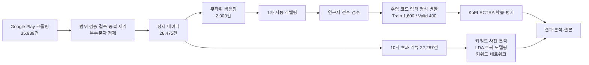

# 💔 데이팅 앱 사용자는 무엇 때문에 1점을 주는가
### — Google Play 리뷰 기반 감성 분류(KoELECTRA)와 불만 요인 텍스트 마이닝

> **한 줄 요약**: 글램·틴더·탄탄 3개 데이팅 앱의 Google Play 리뷰 35,939건을 수집·정제(28,475건)하고, 2,000건을 긍정/부정/중립/관계없음으로 라벨링해 KoELECTRA 감성 분류 모델을 학습했다(검증 정확도 87.75%). 키워드 사전 분석, LDA 토픽 모델링, 키워드 네트워크 분석 결과 **부정 리뷰의 절반은 '돈(결제·환불)' 이야기였고, '매칭'은 오히려 만족의 이유로 더 자주 등장했다.**

| 항목 | 내용 |
|:---|:---|
| 과업 | 문장 분류 (4-class 감성 분류) |
| 데이터 | Google Play 리뷰 — 원본 35,939건 → 정제 28,475건 / 라벨링 2,000건 |
| 모델 | KoELECTRA (수업 배포 소스코드, 변형 없음) |
| 텍스트 마이닝 | 키워드 사전 분석, LDA 토픽 모델링, 키워드 동시출현 네트워크 |
| 부가정보 활용 | 앱(수집 원천) × 작성일(연도) × 별점 |

<br>

## 📑 목차

- [1. 서론](#1-서론)
  - [1.1 왜 이 문제를 해결하려고 하는가](#11-왜-이-문제를-해결하려고-하는가)
  - [1.2 관련 통계와 선행 연구](#12-관련-통계와-선행-연구)
  - [1.3 문제 정의](#13-문제-정의)
- [2. 본론](#2-본론)
  - [2.1 데이터 수집과 원본 EDA](#21-데이터-수집과-원본-eda)
  - [2.2 데이터 정제](#22-데이터-정제)
  - [2.3 데이터 가공 (라벨링)](#23-데이터-가공-라벨링)
  - [2.4 학습 데이터 EDA](#24-학습-데이터-eda)
  - [2.5 모델 학습 (KoELECTRA)](#25-모델-학습-koelectra)
  - [2.6 결과 분석](#26-결과-분석)
- [3. 결론](#3-결론)
- [부록 A. 사용한 방법론 간단 설명](#부록-a-사용한-방법론-간단-설명)
- [부록 B. AI 활용 내역](#부록-b-ai-활용-내역)
- [부록 C. 실행 방법 및 디렉토리 구조](#부록-c-실행-방법-및-디렉토리-구조)
- [참고문헌](#참고문헌)

---

# 1. 서론

## 1.1 왜 이 문제를 해결하려고 하는가

데이팅 앱은 "사람을 만나게 해 준다"는 단순한 가치를 팔지만, 그 가치에 닿기까지의 과정은 점점 복잡해지고 있다. 무료로 시작한 사용자는 곧 **하트·젬·골드·부스터·구독** 같은 유료 재화의 벽을 만나고, 대화 상대가 **실제 사람인지, 운영사가 고용한 알바인지, 사기꾼인지** 확신할 수 없는 상태에서 돈을 쓰게 된다.

흔히 데이팅 앱을 떠나는 이유는 **"원하는 상대와 매칭이 안 돼서"**라고 이야기된다. 실제로 국내 데이팅 앱 이용자 감소를 다룬 기사도 그 원인으로 "낮은 매칭의 질과 정신적 피로감"을 꼽았다[6]. 매칭은 서비스의 본질이므로 불만도 매칭에 모일 것이라는 직관이다.

그러나 사용자가 직접 남긴 리뷰를 읽어 보면 다른 목소리가 들린다.

> *"사기꾼만나서 천만원 털림"* — Tinder, ★1
>
> *"지들 맘대로 결제창도 안띄우고 결제하고 부스터 충전 시키네"* — Tinder, ★1
>
> *"업데이트 후 내가누른 라이크 기능이 사라졌어요"* — Tinder, ★1

이 프로젝트는 **이 직관이 맞는지 데이터로 확인**하는 데서 출발한다. 사용자가 무엇 때문에 화를 내는지 정확히 알아야, 운영사는 매칭 알고리즘을 고칠지 결제 구조와 신뢰 장치를 고칠지 **우선순위를 정할 수 있다.** 또한 매일 쌓이는 리뷰를 사람이 모두 읽을 수는 없으므로, **리뷰 감성을 자동으로 분류하는 모델**이 있으면 강성 불만을 빠르게 걸러 낼 수 있다.

## 1.2 관련 통계와 선행 연구

### (1) 데이팅 앱은 큰 시장이지만, 피해와 불만도 크다

| 구분 | 내용 | 출처 |
|:---|:---|:---:|
| 이용 경험 | 미국 성인의 30%가 데이팅 사이트·앱을 이용해 본 적이 있고, 이용자 중 35%가 유료 기능에 돈을 낸 적이 있다. 자신의 경험을 긍정적으로 본 이용자(53%)와 부정적으로 본 이용자(46%)가 거의 반반이다. | [4] |
| 국내 시장 | 한국 데이팅 앱 월 인앱구매 수익은 2025년 8월 약 1,200만 달러로 역대 최고치를 기록했다. 2025년 1월~2026년 1월 수익 1위는 위피, 2위는 틴더였다. | [5] |
| 국내 피해 경험 | 소개팅 앱 이용 경험자 500명 중 49.8%가 피해를 경험했다. 피해 유형은 원치 않는 지속적 연락(24.4%), 음란한 대화·성적 접촉 유도(23.8%), 금전 요청(10.2%) 순이었다. | [1] |
| 로맨스 스캠 (국내) | 경찰청 집계 로맨스 스캠은 2022년 47,087건으로 2017년(17,073건) 대비 176% 증가했다. | [2] |
| 로맨스 스캠 (미국) | 2022년 약 7만 명이 로맨스 스캠을 신고했고 신고 피해액은 13억 달러였다. FTC는 사기범이 데이팅 앱을 통해 접근하는 경우가 많다고 보고했다. | [3] |
| 결제·환불 분쟁 | 국내 결혼 중개 서비스 피해구제 1,236건(2023~2025년) 중 56.1%가 '계약 해지·위약금' 문제였다. 만남 서비스 전반에서 **돈을 돌려받는 문제**가 핵심 분쟁임을 보여 준다. | [7] |

정리하면, 데이팅 서비스의 문제는 "매칭 실패"만이 아니라 **금전(결제·환불)**과 **신뢰(가짜 계정·사기)**의 문제로도 나타난다. 다만 이 통계들은 설문·신고 자료로, **사용자가 앱 안에서 실제로 무엇에 가장 많이 불만을 표현하는지**를 직접 보여 주지는 않는다. 본 프로젝트는 이 빈틈을 **앱 리뷰 텍스트**로 메운다.

### (2) 앱 리뷰 분석에 대한 선행 연구

- **앱 리뷰는 개발에 쓸 수 있는 정보원이다.** Pagano & Maalej(2013)는 앱스토어 리뷰를 실증 분석해, 리뷰의 약 3분의 1이 버그 신고·기능 요청 등 서비스 개선과 관련된 정보를 담고 있음을 보였다[8].
- **별점만으로는 부족하고 텍스트 감성을 봐야 한다.** Guzman & Maalej(2014)는 앱 리뷰에서 기능(feature)을 추출하고 기능별 감성을 계산했다. 기능 추출에는 토픽 모델링(LDA)을 사용했다[9]. 본 프로젝트의 "불만 요인별 분석 + 토픽 모델링" 구성은 이 접근을 참고했다.
- **사전학습 언어 모델.** ELECTRA는 "가짜로 바꿔 넣은 토큰을 찾아내는" 방식으로 사전학습해, 같은 연산량에서 BERT보다 효율적으로 학습하는 모델이다[10]. KoELECTRA는 이를 대규모 한국어 말뭉치로 사전학습한 모델이다[11].
- **토픽 모델링과 네트워크 분석.** LDA는 문서를 여러 주제의 혼합으로 보고, 주제를 단어 분포로 나타내는 확률 모델이다[12]. 키워드 네트워크의 군집은 모듈성(modularity)을 최대화하는 방식으로 찾는다[13].

## 1.3 문제 정의

> **핵심 질문**
> **"데이팅 앱 사용자의 강한 불만(1~2점 리뷰)은 '매칭 실패'에서 오는가, 아니면 '돈(과금·결제·환불)'과 '신뢰(가짜 계정·사기)'의 문제에서 오는가? 그리고 이 불만은 앱과 시기에 따라 어떻게 다른가?"**

| 구분 | 질문 | 검증 방법 | 결과 위치 |
|:---:|:---|:---|:---:|
| **RQ1** | 부정 리뷰에서 가장 많이, 가장 강하게 언급되는 불만 요인은 무엇이며, '매칭'은 몇 순위인가? | 불만 요인 키워드 사전 분석 (부정 vs 긍정 비교) | §2.6.1 |
| **RQ2** | 사전을 쓰지 않아도 같은 결론이 나오는가? | LDA 토픽 모델링, 키워드 동시출현 네트워크 | §2.6.3~2.6.4 |
| **RQ3** | 앱(수집 원천)과 시기(작성일)에 따라 불만 구조가 다른가? | 앱별·연도별 토픽/요인 비율 비교 | §2.6.2~2.6.3 |
| **RQ4** | 리뷰 텍스트만으로 4-class 감성을 자동 분류할 수 있는가? | KoELECTRA 학습 및 평가 | §2.5 |

**용어 정의**

| 용어 | 이 보고서에서의 정의 |
|:---|:---|
| 부정 리뷰 / 긍정 리뷰 | 텍스트 마이닝(§2.6)에서는 **별점 1~2점 / 4~5점** 리뷰. 모델 학습(§2.3~2.5)에서는 **사람이 텍스트를 읽고 붙인 감성 라벨**을 사용한다. |
| 불만 요인 | 부정 리뷰가 문제 삼는 대상. 과금·결제, 환불, 알바·가짜계정, 스캠·사기, 오류·버그, 계정정지, 매칭 등 10개 요인과 4개 범주(돈·신뢰·매칭·기술)로 정의한다(§2.6.1). |
| 감성 분류 과업 | 리뷰 한 문장(또는 짧은 글)을 입력받아 **긍정 / 부정 / 중립 / 관계없음** 중 하나로 분류하는 문장 분류 과업 |

**분석 대상 앱**

| 구분 | 앱 | 특징 | 수집 리뷰 수 |
|:---:|:---|:---|---:|
| 국내 | **글램 (Glam)** | 국내 소개팅 앱, 프로필 매력도 기반 추천, 유료 재화 '젬' | 17,000 |
| 글로벌 | **틴더 (Tinder)** | 세계 최대 스와이프형 매칭 앱, 골드·부스터 등 구독/아이템 | 10,326 |
| 글로벌 | **탄탄 (Tantan)** | 중국 기반 아시아권 스와이프형 소셜 앱, VIP 구독 | 8,613 |

---

# 2. 본론

## 전체 파이프라인



| 단계 | 스크립트 | 입력 → 출력 |
|:---|:---|:---|
| ① 수집 | (크롤러) / `01_review_crawler.py` | Google Play → `dating_app_50k_eunsun.csv` (증강 실험 포함, §2.1.4) |
| ② 정제 · 샘플링 | `02_preprocessing.py` | → `dating_app_cleaned_all.csv`, `dating_app_labeling_2000.csv` |
| ③ 원본 EDA | `03_eda.py` | → `figures/raw_*.png` |
| ④ 1차 라벨링 | `04_auto_labeling.py` | → `dating_app_labeling_2000.csv` (이후 수동 검수) |
| ⑤ 형식 변환 · 학습 데이터 EDA | `05_model_train.py` | → `ratings_train2.txt`, `figures/train_*.png` |
| ⑥ 모델 학습 | `KOELECTRA-Finetune.py` (수업 코드) | → `koelectra-base-discriminator/` (학습된 모델) |
| ⑦ 검증 예측 | `09_evaluate.py` | → `results/test_predictions.csv` |
| ⑦-2 학습 곡선 · 평가 | `08_plot_training.py` | → `figures/model_*.png`, `results/classification_report.csv` |
| ⑧ 불만 요인 분석 | `06_topic_analysis.py` | → `figures/mining_1~4`, `results/topic_*.csv` |
| ⑨ 토픽 모델링 · 네트워크 | `07_text_mining.py` | → `figures/mining_5~9`, `results/lda_*.csv`, `results/network_*.csv` |

---

## 2.1 데이터 수집과 원본 EDA

### 2.1.1 무엇을, 어디에서, 얼마나

| 항목 | 내용 |
|:---|:---|
| **출처** | Google Play Store 사용자 리뷰 (한국어) |
| **수집 도구** | Python `google-play-scraper` — 크롤링 코드는 Google AI Pro(Gemini)를 활용해 작성 후 실행 |
| **수집 규모** | **35,939건** (Glam 17,000 / Tinder 10,326 / Tantan 8,613) |
| **작성일 범위** | 2013-09-04 ~ 2026-09-20 |
| **수집 컬럼** | `앱이름`(수집 원천), `리뷰내용`, `별점`(1~5), `작성일`(일시) |
| **원본 파일** | `dating_app_50k_eunsun.csv` |

| 앱 | 가장 오래된 리뷰 | 가장 최근 리뷰 | 평균 별점 |
|:---|:---:|:---:|:---:|
| Glam | 2019-02-12 | 2026-09-17 | 3.89 |
| Tinder | 2013-09-04 | 2026-09-20 | 2.65 |
| Tantan | 2015-09-30 | 2026-01-13 | 3.09 |

### 2.1.2 원본 데이터 EDA — 핵심 특성

**① 앱별 리뷰 수**


Glam이 전체의 47.3%로 가장 많고, Tinder 28.7%, Tantan 24.0% 순이다. 앱 간 표본 크기가 다르므로 이후 비교는 **건수가 아닌 비율**로 한다.

**② 별점 분포 — 극단적 양극화**


| 별점 | ★1 | ★2 | ★3 | ★4 | ★5 |
|:---|---:|---:|---:|---:|---:|
| 건수 | 12,012 | 1,322 | 2,130 | 3,429 | 17,046 |
| 비율 | 33.4% | 3.7% | 5.9% | 9.5% | **47.4%** |

**1점과 5점이 전체의 80.8%**를 차지한다. 리뷰는 무난한 경험보다 **크게 만족했거나 크게 화가 났을 때** 주로 작성된다.

**③ 앱별 별점 구성**


| 앱 | ★1 | ★2 | ★3 | ★4 | ★5 |
|:---|---:|---:|---:|---:|---:|
| Glam | 20.1% | 2.8% | 5.3% | 11.9% | **59.9%** |
| Tinder | **49.1%** | 5.3% | 7.8% | 7.7% | 30.1% |
| Tantan | 41.0% | 3.4% | 5.0% | 7.0% | 43.6% |

세 앱 모두 양극화되어 있지만 **방향이 다르다.** Glam은 5점 쪽으로, Tinder는 1점 쪽으로 기울어 있다.

**④ 연도별 리뷰 수 (일시 정보)**


리뷰는 2019~2021년에 가장 많이 작성되었고(2020년 9,034건 최대), 이후 줄어든다. Glam은 2019년부터, Tantan은 2023년 이후 리뷰가 거의 없다. 따라서 **연도별 비교는 앱 구성의 변화가 섞이지 않도록 앱별로 나누어 본다**(§2.6.3).

**⑤ 리뷰 길이**


| 평균 | 표준편차 | 1사분위 | 중앙값 | 3사분위 | 최대 |
|---:|---:|---:|---:|---:|---:|
| 43.6자 | 63.6 | 5자 | **19자** | 54자 | 584자 |

절반 이상이 20자 미만의 짧은 리뷰이며, 일부 긴 리뷰가 평균을 끌어올리는 오른쪽 꼬리가 긴 분포다.

**⑥ 별점별 리뷰 길이**


| 별점 | ★1 | ★2 | ★3 | ★4 | ★5 |
|:---|---:|---:|---:|---:|---:|
| 길이 중앙값 | **45자** | 42자 | 30자 | 13자 | **7자** |

**1점 리뷰의 중앙 길이는 5점 리뷰의 약 6배**다. 만족한 사용자는 "굿", "좋아요"처럼 짧게 쓰고, 불만이 있는 사용자는 **무슨 일이 있었는지 경위를 설명한다.** 즉 부정 리뷰가 서비스 개선에 쓸 정보를 가장 많이 담고 있다.

### 2.1.3 원본 데이터 품질 점검 요약

| 점검 항목 | 결과 |
|:---|:---|
| 결측치 | `리뷰내용` 18건 (나머지 컬럼 0건) |
| 리뷰내용 중복 | 7,353건 — "굿"(1,507), "좋아요"(1,499), "굳"(319), "Good"(286), "좋음"(217) 등 짧은 긍정 표현이 대부분 |
| 별점 범위 | 1~5 범위 밖 값 없음 |
| 작성일 | 파싱 실패 없음, 2013-09 ~ 2026-09 |

### 2.1.4 데이터 규모에 대한 설명 — 증강 데이터는 사용하지 않음

초기에는 5만 건 요건을 맞추기 위해 `01_review_crawler.py`로 템플릿 기반 증강 데이터 16,561건을 만들어 52,500건(`dating_app_50k_final.csv`)을 구성했다. 그러나 확인 결과 **분석에 쓰지 않는 것이 맞다**고 판단했다.

| 문제 | 내용 |
|:---|:---|
| 다양성 없음 | 16,561건이 **고유 문장 135개**의 반복이다. 모델이 템플릿을 외울 뿐 일반화에 도움이 되지 않는다. |
| 결론을 미리 정해 둠 | 생성 코드가 부정 60% / 긍정 25% / 중립 15%의 비율을 미리 정해 두어, 이 데이터로 "부정이 많다"고 결론 내리면 **순환 논증**이 된다. |
| 실제 리뷰 없는 앱 포함 | 증강 데이터의 위피·아만다는 실제 수집 리뷰가 0건이다. |

본 보고서의 모든 분석과 모델 학습은 **실제 수집 리뷰만** 사용한다. 실제 데이터는 정제 후 28,475건으로 권장 기준(정제 후 25,000건 이상)을 충족한다.

---

## 2.2 데이터 정제

### 2.2.1 정제 단계 (`02_preprocessing.py`)

| 단계 | 처리 | 제거 | 남은 건수 |
|:---:|:---|---:|---:|
| 0 | 원본 로드 | – | 35,939 |
| 1 | **데이터 범위 검증** — 별점 1~5, 작성일 파싱 가능, 앱 3종 확인 | 0 | 35,939 |
| 2 | **결측치 제거** — `리뷰내용`이 비어 있는 행 | 18 | 35,921 |
| 3 | **중복 제거** — `리뷰내용`이 완전히 같은 행은 첫 번째만 유지 | 7,336 | 28,585 |
| 4 | **텍스트 정제** — 한글(완성형·자모)·영문·숫자·공백 외 문자 제거 | – | – |
| 5 | **빈 리뷰 제거** — 정제 후 글자가 남지 않은 행 (이모지만 있던 리뷰 등) | 110 | **28,475** |

원본 대비 **79.2%**를 유지했다.

```python
def clean_text(text):
    text = re.sub(r'[^가-힣ㄱ-ㅎㅏ-ㅣa-zA-Z0-9\s]', '', str(text))
    return text.strip()
```

### 2.2.2 정제 기준을 이렇게 정한 이유

- **자모(ㅋ, ㅠ, ㅎ)를 남긴 이유**: `ㅋㅋ`, `ㅠㅠ`는 리뷰 감성을 드러내는 중요한 신호이기 때문이다.
- **중복을 제거한 이유**: 같은 문장이 학습 세트와 테스트 세트에 동시에 들어가면 모델 성능이 실제보다 좋게 측정된다(**데이터 누수**). 중복 제거로 짧은 긍정 리뷰가 많이 빠지면서 5점 비율이 47.4% → 37.9%, 평균 별점이 3.34 → 2.98로 바뀌었다. 이는 이후 분석이 "굿"·"좋아요" 같은 반복 표현이 아니라 **서로 다른 내용의 리뷰**를 기준으로 한다는 뜻이다.
- **길이 기준(데이터 범위)을 용도별로 다르게 둔 이유**:

| 용도 | 길이 기준 | 이유 |
|:---|:---|:---|
| 감성 분류 (라벨링·모델 학습) | **제한 없음** | 실제 서비스에는 "굿", "ㅎ" 같은 짧은 리뷰도 들어오므로 모델이 이를 처리할 수 있어야 한다. '관계없음' 클래스도 이런 짧은 텍스트로 이루어진다. |
| 텍스트 마이닝 (§2.6.3~2.6.4) | **10자 이하 제거** → 22,287건 | 토픽·키워드 분석은 **내용**을 보는 것이 목적이므로, 명사를 거의 포함하지 않는 짧은 리뷰는 잡음이 된다. |

### 2.2.3 정제 후 데이터 요약

| 앱 | 리뷰 수 | 비율 | 평균 별점 |
|:---|---:|---:|---:|
| Glam | 12,957 | 45.5% | 3.62 |
| Tinder | 8,939 | 31.4% | 2.33 |
| Tantan | 6,579 | 23.1% | 2.59 |
| **합계** | **28,475** | 100% | 2.98 |

| 별점 | ★1 | ★2 | ★3 | ★4 | ★5 |
|:---|---:|---:|---:|---:|---:|
| 건수 (비율) | 11,812 (41.5%) | 1,288 (4.5%) | 1,941 (6.8%) | 2,629 (9.2%) | 10,805 (37.9%) |

---

## 2.3 데이터 가공 (라벨링)

### 2.3.1 라벨 정의

별점이 아니라 **텍스트 내용**을 기준으로 4개 클래스를 정의했다. 모델은 텍스트만 입력받기 때문이다.

| 라벨 | 정의 | 판단 기준 | 예시 (실제 리뷰) |
|:---:|:---|:---|:---|
| **긍정** | 앱·경험에 대한 만족, 추천 | 칭찬, 추천, 좋은 결과 보고가 중심 | "덕분에 좋은 인연 만들었습니다" |
| **부정** | 앱·경험에 대한 불만, 피해, 항의 | 불만, 비난, 피해 호소, 환불·정지 해제 요구가 중심 | "쓰지마세요 돈아까움" |
| **중립** | 평가가 뚜렷하지 않거나 장단점이 비슷하게 섞임 | "그저 그렇다", 단순 기능 제안, 장단점 병기 | "그냥 저냥임", "그저나쁘진않아" |
| **관계없음** | 감성을 판단할 수 없는 텍스트 | 의미 없는 문자, 앱과 무관한 내용 | "w", "음", "ㅎ" |

**경계 사례 처리 규칙**

| 경계 사례 | 결정 | 이유 |
|:---|:---:|:---|
| 부정 키워드가 부정어로 부정됨 ("과금유도를 안 해서 좋네요") | 긍정 | 문장 전체의 평가는 긍정 |
| 단순 환불 요청 ("잘못 결제했어요 환불 부탁드립니다") | 부정 | 사용자가 불편을 겪고 조치를 요구 |
| 칭찬 + 작은 개선 요청 | 긍정 | 전체 평가는 만족 |
| 장점과 단점이 비슷한 비중 ("괜찮은데 캐시가 너무 비싸요") | 중립 | 한쪽으로 기울지 않음 |
| 별점과 텍스트가 충돌 (★5인데 불만 내용) | **텍스트 우선** | 모델 입력은 텍스트뿐 |
| "굿", "오키" 등 짧은 평가 표현 | 긍정 | 의미 있는 평가 표현 |

### 2.3.2 라벨링 절차

| 단계 | 내용 | 도구 |
|:---:|:---|:---|
| ① 샘플링 | 정제 데이터 28,475건 중 **2,000건 무작위 추출** (`random_state=42`) — Glam 933 / Tinder 584 / Tantan 483 | `02_preprocessing.py` |
| ② 1차 자동 라벨링 | 빠른 초안 작성 (아래 규칙) | `04_auto_labeling.py` (키워드·별점 규칙) |
| ③ 연구자 전수 검수 | 2,000건 전체를 연구자가 직접 읽고 §2.3.1 기준에 맞게 수정 | 직접 검수 |
| ④ 표기 통일·형식 변환 | `관련없음` → `관계없음` 오타 통일, 수업 코드 입력 형식(`ratings_train2.txt`)으로 변환 | `05_model_train.py` |

**1차 자동 라벨링 규칙**

```
1. 2자 미만 또는 'ㅇㅇ','ㅋㅋ','ㅎㅎ','굿' → 관계없음
2. 부정 키워드(알바, 사기, 환불, 결제, 쓰레기, 최악, 돈, 과금, 오류, 정지, 차단, 광고) 포함 → 부정
3. 그 외: 별점 4~5 → 긍정 / 1~2 → 부정 / 3 → 중립
```

**우선 검수 대상** — 1차 규칙이 틀리기 쉬운 유형을 먼저 검수했다.

| 대상 | 건수 | 이유 |
|:---|---:|:---|
| 별점 4~5점인데 1차 라벨 '부정' | 140 | 부정어("없음", "안 함")나 긍정 맥락의 키워드로 인한 오분류 가능성 |
| 별점 3점인데 1차 라벨 '부정' | 46 | 중립적 문의를 부정으로 분류했을 가능성 |
| 1차 라벨 '관계없음' 전체 | 7 | "굿", "굳" 같은 짧은 긍정 표현 포함 가능 |

### 2.3.3 검수 결과

| 항목 | 값 |
|:---|---:|
| 검수 대상 | 2,000건 (전수) |
| 1차 라벨에서 수정된 건수 | **10건 (0.5%)** |
| 표기 통일 | `관련없음` → `관계없음` 1건 |

| 1차 라벨 → 최종 라벨 | 건수 |
|:---|---:|
| 부정 → 긍정 | 5 |
| 긍정 → 중립 | 2 |
| 긍정 → 관계없음 | 1 |
| 긍정 → 부정 | 1 |
| 중립 → 부정 | 1 |

1차 규칙 라벨의 99.5%를 그대로 유지했다. 리뷰 대부분은 별점과 텍스트 감성이 같은 방향이어서 규칙이 맞게 분류했고, **문맥을 읽어야 하는 소수의 리뷰에서만 사람의 판단이 필요했다.**

### 2.3.4 검수에서 수정한 대표 사례

| 리뷰 | 별점 | 1차 라벨 | 최종 라벨 | 규칙이 틀린 이유 |
|:---|:---:|:---:|:---:|:---|
| "결제할만함" | ★4 | 부정 | 긍정 | '결제' 키워드가 긍정 맥락으로 쓰임 |
| "좋은 어플인 것 같아요 근데 모델같은 분들이 많은데 설마 알바는 아니져" | ★5 | 부정 | 긍정 | '알바' 키워드가 있지만 전체 평가는 만족 |
| "…다른앱은 결제 유도 너무 심한데 글램은 그런것도 없고 최곱니다…" | ★5 | 부정 | 긍정 | 다른 앱과 비교하며 쓴 '결제 유도' |
| "그냥 저냥임" | ★4 | 긍정 | 중립 | 별점만 보고 긍정 처리 |
| "그닥" | ★5 | 긍정 | 중립 | 별점과 텍스트 감성이 다름 |
| "상대방성별선택이안됨 가입시" | ★5 | 긍정 | 부정 | 별점은 높지만 내용은 기능 오류 신고 |
| "거리설정을해도 외국인 매치가 왜뜨는지" | ★3 | 중립 | 부정 | 3점이지만 내용은 불만 |
| "오키" | ★5 | 긍정 | 관계없음 | 평가 내용이 없는 짧은 응답 |

단어 규칙은 **키워드가 어떤 맥락에서 쓰였는지, 별점과 글이 어긋나는지를 판단하지 못한다.** 이것이 문맥을 읽는 언어 모델(KoELECTRA)을 학습하는 이유다.

---

## 2.4 학습 데이터 EDA

### 2.4.1 라벨 분포와 Train/Test 분할


| 라벨 | 번호 | 전체 | 비율 | Train | Valid |
|:---:|:---:|---:|---:|---:|---:|
| 부정 | 0 | 1,115 | 55.8% | 893 | 222 |
| 긍정 | 1 | 778 | 38.9% | 616 | 162 |
| 중립 | 2 | 100 | 5.0% | 86 | 14 |
| 관계없음 | 3 | 7 | 0.4% | 5 | 2 |
| **합계** | | **2,000** | 100% | **1,600** | **400** |

- 학습/검증 분할은 **수업 코드 안에서** `train_test_split(test_size=0.2, random_state=2026)`으로 이루어진다. 위 표는 같은 방식으로 미리 나눠 본 결과다(`05_model_train.py`).
- 라벨 번호는 수업 예제의 의미(0=부정, 1=긍정)를 그대로 유지하고 2=중립, 3=관계없음을 추가했다.
- **심한 클래스 불균형**: 중립(5.0%)과 관계없음(0.4%)이 매우 적다. 검증 세트의 관계없음은 2건뿐이다. 이는 §2.1.2의 별점 양극화가 그대로 반영된 결과다. 정확도(Accuracy)만 보면 소수 클래스의 실패가 가려지므로, 평가는 **클래스별 F1과 Macro-F1**을 함께 본다.

### 2.4.2 앱별 라벨 구성 — 문제 정의와의 연결


| 앱 | 긍정 | 부정 | 중립 | 관계없음 |
|:---|---:|---:|---:|---:|
| Glam (n=933) | **53.7%** | 40.7% | 5.1% | 0.4% |
| Tinder (n=584) | 23.8% | **70.0%** | 5.7% | 0.5% |
| Tantan (n=483) | 28.6% | **67.5%** | 3.9% | 0.0% |

텍스트 기준 라벨에서도 Tinder·Tantan은 부정이 3분의 2를 넘고, Glam은 긍정이 더 많다. 별점 분포(§2.1.2)와 같은 방향이다.

### 2.4.3 별점과 텍스트 감성이 어긋나는 리뷰


**별점과 감성 라벨의 방향이 반대인 리뷰가 140건(7.0%)**이다(별점 4~5점인데 부정). 예를 들어 5점을 주고 "실수로 결제했으니 환불해 달라"고 쓰는 경우다. **별점만으로 감성을 판단하면 이런 리뷰를 놓친다**는 점이 텍스트 분류 모델이 필요한 이유다.

### 2.4.4 라벨별 리뷰 길이


| 라벨 | 평균 | 중앙값 |
|:---:|---:|---:|
| 부정 | 66.2자 | **45자** |
| 중립 | 39.5자 | 27자 |
| 긍정 | 35.2자 | **15자** |
| 관계없음 | 1.1자 | 1자 |

부정 리뷰가 가장 길다. 모델 입력 길이(`max_length`)를 정할 때 **긴 부정 리뷰가 잘리지 않도록** 고려해야 한다.

### 2.4.5 라벨별 상위 명사


| 라벨 | 상위 명사 (등장 리뷰 수) |
|:---:|:---|
| 긍정 | **매칭**(46), 친구(37), 프로필(29), 대화(28), 소개팅(27), 인연(26), 무료(26), 추천(23) |
| 부정 | **결제**(334), **환불**(181), 취소(121), 자동(91), 대화(81), 알바(81), 매칭(81), 사기(74), 계정(72) |

**긍정 리뷰의 1위 명사가 '매칭'**이고, **부정 리뷰의 1·2위는 '결제'와 '환불'**이다. 학습 데이터에서부터 핵심 질문에 대한 답의 윤곽이 보인다. 이를 전체 데이터로 확장한 분석이 §2.6이다.

---

## 2.5 모델 학습 (KoELECTRA)

### 2.5.1 모델과 학습 환경

| 항목 | 내용 |
|:---|:---|
| 모델 코드 | 수업 배포 코드 `KOELECTRA-Finetune.py` |
| 사전학습 가중치 | `monologg/koelectra-base-v3-discriminator` |
| 입력 / 출력 | `document`(리뷰내용) → `label` 4-class (0 부정 / 1 긍정 / 2 중립 / 3 관계없음) |
| 입력 파일 | `ratings_train2.txt` (수업 코드가 읽는 파일 이름·형식 그대로, 내용만 우리 데이터 2,000건) |
| 학습 / 검증 | 수업 코드 내부 분할 8:2 (`random_state=2026`) → 1,600 / 400 |
| max_length | 256 |
| batch size | 32 |
| epochs | 4 |
| optimizer / learning rate | AdamW / 5e-5 (eps 1e-8), linear scheduler (warmup 0), gradient clipping 1.0 |
| 학습 환경 | 로컬 PC, NVIDIA GPU (CUDA), PyTorch 2.5.1 conda 환경 |

**수업 코드에서 바꾼 부분은 한 줄뿐이다.**

```diff
  model = ElectraForSequenceClassification.from_pretrained(
      'monologg/koelectra-base-v3-discriminator',
-     num_labels=2
+     num_labels=4
  )
```

수업 예제는 긍정/부정 2-class였고 본 과업은 4-class이므로, 출력 클래스 수만 4로 바꿨다. 데이터 읽기·토큰화·분할·학습·평가 코드는 그대로 사용했다. 수업 코드는 정확도만 출력하므로, 혼동 행렬과 클래스별 F1은 저장된 모델을 불러오는 별도 스크립트(`09_evaluate.py`)로 계산했다.

### 2.5.2 Epoch별 Loss와 정확도


| Epoch | Train Loss | Train Acc | Valid Acc |
|:---:|---:|---:|---:|
| 1 | 0.8137 | 86.12% | 84.75% |
| 2 | 0.4670 | 91.13% | 87.00% |
| 3 | 0.3174 | 93.06% | **88.75%** |
| 4 | 0.2435 | 93.44% | 87.75% |

*(수업 코드는 검증 loss를 출력하지 않으므로 검증은 정확도로 본다.)*

**해석**
- Train loss는 0.81 → 0.24로 꾸준히 줄었고, 검증 정확도는 1 epoch부터 84.75%로 빠르게 올라갔다. 사전학습된 언어 모델이라 적은 데이터(1,600건)로도 빨리 수렴했다.
- 검증 정확도는 **3 epoch(88.75%)에서 가장 높고 4 epoch에서 87.75%로 약간 내려갔다.** 반면 Train 정확도는 계속 올랐다(93.06% → 93.44%). 4 epoch 무렵부터 **과적합이 시작**되는 신호로 볼 수 있다.
- 수업 코드는 4 epoch 학습 후 마지막 모델을 저장하므로, 아래 평가는 4 epoch 모델 기준이다.

### 2.5.3 평가 결과

| 클래스 | Precision | Recall | F1-score | Support |
|:---:|---:|---:|---:|---:|
| 긍정 | 0.851 | 0.914 | **0.881** | 162 |
| 부정 | 0.898 | 0.914 | **0.906** | 222 |
| 중립 | 0.000 | 0.000 | 0.000 | 14 |
| 관계없음 | 0.000 | 0.000 | 0.000 | 2 |
| **Accuracy** | | | **0.878** | 400 |
| **Macro-F1** | | | **0.447** | 400 |
| Weighted-F1 | | | 0.860 | 400 |

**혼동 행렬 (검증 400건)**

| 정답 \ 예측 | 긍정 | 부정 | 중립 | 관계없음 |
|:---|---:|---:|---:|---:|
| 긍정 (162) | **148** | 14 | 0 | 0 |
| 부정 (222) | 19 | **203** | 0 | 0 |
| 중립 + 관계없음 (16) | 7 | 9 | 0 | 0 |

*(중립과 관계없음은 모두 긍정 또는 부정으로 예측되었다.)*

**비교 기준선 (Baseline)**

| 방법 | Accuracy | Macro-F1 |
|:---|---:|---:|
| 최빈 클래스('부정')만 예측 | 55.5% | 17.8% |
| **KoELECTRA (수업 코드, 4 epoch)** | **87.8%** | **44.7%** |

> 검증 400건을 모두 '부정'으로 찍기만 해도 정확도는 55.5%가 나온다. KoELECTRA는 이보다 **32.3%p 높고**, Macro-F1도 17.8% → 44.7%로 2.5배 올랐다.

### 2.5.4 결과 해석

1. **긍정·부정은 잘 구분한다.** 긍정 F1 0.881, 부정 F1 0.906이다. 특히 본 프로젝트의 활용 목적인 **강성 불만 감지**에 중요한 부정 리뷰 재현율(Recall)이 91.4%로, 실제 부정 리뷰 10건 중 9건 이상을 찾아낸다.
2. **중립·관계없음은 하나도 맞히지 못했다(F1 0).** 모델은 이 두 클래스를 한 번도 예측하지 않았다. 학습 데이터에 중립 86건(5.4%), 관계없음 5건(0.3%)뿐이라, 모델 입장에서는 이 클래스를 무시해도 정확도가 거의 떨어지지 않기 때문이다. 이것이 **정확도(87.8%)와 Macro-F1(44.7%)의 차이**가 큰 이유이며, 불균형 데이터에서 정확도만 보면 안 되는 이유다.
3. **결국 현재 모델은 사실상 '긍정/부정 2-class 분류기'로 동작한다.** 중립·관계없음을 분류하려면 이 클래스의 학습 데이터를 늘려야 한다(§3.3).

### 2.5.5 오류 유형

- 틀린 49건 중 **긍정 ↔ 부정 혼동이 33건**(부정→긍정 19, 긍정→부정 14)이다. 별점과 감성이 어긋나거나(§2.4.3), 한 리뷰 안에 칭찬과 불만이 섞인 경우가 많다.
- 나머지 16건은 중립·관계없음 리뷰를 긍정(7)이나 부정(9)으로 예측한 경우다.
- 틀린 리뷰 원문은 `results/valid_predictions_detail.csv`에 저장되어 있다.

---

## 2.6 결과 분석

> 이 절은 **정제 데이터 전체(28,475건)**를 대상으로, §1.3의 RQ1~RQ3에 답한다. 세 가지 방법을 함께 쓴다.
>
> | 방법 | 특징 | 역할 |
> |:---|:---|:---|
> | ① 키워드 사전 분석 | 연구자가 정의한 요인별 키워드로 집계 — **해석이 명확** | 가설 검증 (RQ1) |
> | ② LDA 토픽 모델링 | 사전 없이 데이터에서 주제를 찾음 — **연구자 편향이 적음** | ①의 결과 교차 검증 (RQ2) |
> | ③ 키워드 네트워크 | 단어가 함께 쓰이는 구조를 시각화 | 불만이 어떻게 연결되는지 (RQ2) |
>
> 부가정보인 **앱(수집 원천)**과 **작성일(일시)**을 모든 분석에 교차 적용한다(RQ3).

### 2.6.1 불만 요인 키워드 사전 분석 (RQ1)

**방법**: 정제 데이터를 부정 리뷰(★1~2, 13,100건)와 긍정 리뷰(★4~5, 13,434건)로 나누고, 요인별 키워드가 하나라도 포함된 리뷰의 비율을 비교한다. **부정 리뷰에서 특히 자주 나오는 요인**을 찾기 위해 "부정 언급률 ÷ 긍정 언급률"(배율)을 함께 본다. (`06_topic_analysis.py`)

| 요인 | 키워드 사전 |
|:---|:---|
| 과금·결제 | 결제, 과금, 유료, 젬, 하트, 구독, 비싸, 가격, 충전, 요금, 돈 |
| 환불 | 환불 |
| 알바·가짜계정 | 알바, 가짜, 허위, 매크로, 도용, 봇계정, 유령 |
| 스캠·사기 | 사기, 스캠, 피싱, 몸캠, 코인, 주식, 투자 |
| 조건만남·성매매 | 조건, 성매매, 업소, 유흥, 스폰 |
| 오류·버그 | 오류, 에러, 버그, 튕, 먹통, 렉, 로딩, 접속, 로그인, 인증 |
| 계정정지 | 정지, 영구, 밴 |
| 매칭 | 매칭, 매치, 연결, 좋아요, 라이크 |
| 외모·심사 | 외모, 심사, 등급, 티어, 평가 |
| 성비·이성 | 성비, 남자, 여자 |


| 요인 | 부정 리뷰 언급률 | 긍정 리뷰 언급률 | 배율 |
|:---|---:|---:|---:|
| **과금·결제** | **45.8%** | 12.6% | 3.6배 |
| **환불** | 17.9% | 1.9% | **9.6배** |
| 매칭 | 17.6% | 20.8% | **0.85배** |
| 오류·버그 | 12.2% | 3.6% | 3.4배 |
| 알바·가짜계정 | 11.1% | 2.8% | 4.0배 |
| **스캠·사기** | 9.5% | 1.5% | **6.4배** |
| 성비·이성 | 5.2% | 3.8% | 1.4배 |
| **계정정지** | 2.9% | 0.4% | **7.9배** |
| 조건만남·성매매 | 1.8% | 0.9% | 1.9배 |
| 외모·심사 | 1.6% | 2.1% | 0.77배 |

| 범주 | 포함 요인 | 부정 리뷰 언급률 |
|:---|:---|---:|
| 💸 **돈** | 과금·결제, 환불 | **49.6%** |
| 🕵️ **신뢰** | 알바·가짜계정, 스캠·사기, 조건만남·성매매 | **19.9%** |
| 💘 매칭 | 매칭 | 17.6% |
| 🛠️ 기술 | 오류·버그 | 12.2% |

*(한 리뷰가 여러 범주를 동시에 언급할 수 있어 합계는 100%가 아니다.)*

**해석**
1. **부정 리뷰의 절반(49.6%)이 돈 이야기다.** 불만 1순위는 매칭이 아니라 결제와 환불이다.
2. **매칭은 오히려 긍정 리뷰에서 더 자주 나온다(배율 0.85).** "매칭이 잘 된다"처럼 만족의 이유로 쓰이는 경우가 많다. 즉 **매칭 언급만으로는 불만을 구별할 수 없다.**
3. **환불(9.6배), 계정정지(7.9배), 스캠·사기(6.4배)**는 빈도는 낮아도 일단 등장하면 거의 확실히 부정 리뷰다. 사용자가 **금전적 손해나 통제할 수 없는 피해**를 입었다고 느끼는 지점이다.

### 2.6.2 앱별 불만 구조 (RQ3 — 수집 원천)


| 범주 | Glam (n=3,823) | Tinder (n=5,545) | Tantan (n=3,732) |
|:---|---:|---:|---:|
| 💸 돈 | 35.4% | 46.0% | **69.3%** |
| 🕵️ 신뢰 | **32.0%** | 12.5% | 18.3% |
| 💘 매칭 | **27.0%** | 13.9% | 13.6% |
| 🛠️ 기술 | 13.8% | **16.2%** | 4.6% |

- **Tantan**: 부정 리뷰의 69.3%가 돈 문제이고, 환불 언급이 26.7%로 세 앱 중 가장 높다.
- **Tinder**: 돈(46.0%)에 더해 오류·버그(16.2%)와 계정정지(4.2%)가 세 앱 중 가장 높다.
- **Glam**: 돈 문제 비중은 가장 낮지만, **알바·가짜계정 의심이 24.4%**로 다른 두 앱(5~7%)의 4배 수준이다.

> 💡 "글로벌 앱은 사기, 국내 앱은 과금"이라는 예상과 반대로, **과금 불만은 글로벌 앱에서, 가짜 계정 불신은 국내 앱(Glam)에서 더 컸다.**

### 2.6.3 LDA 토픽 모델링 — 사전 없이 찾은 불만 주제 (RQ2, RQ3)

**방법** (`07_text_mining.py`, 방법론 설명은 [부록 A](#부록-a-사용한-방법론-간단-설명))
1. 10자 초과 부정 리뷰(★1~2)에서 Kiwi 형태소 분석기로 **2글자 이상 명사**만 추출하고, 의미 없는 명사(어플, 사용, 사람 등)는 불용어로 제거했다.
2. 명사가 하나 이상 남은 **11,517건 × 809개 단어**의 문서-단어 행렬로 LDA를 학습했다.
3. 토픽 수 k를 3~10까지 바꾸며 perplexity를 비교했다.


| k | 3 | 4 | 5 | **6** | 7 | 8 | 9 | 10 |
|:---|---:|---:|---:|---:|---:|---:|---:|---:|
| perplexity | 206.0 | 196.3 | 196.9 | **200.9** | 208.3 | 202.4 | 204.2 | 208.1 |

k=4~6의 perplexity 차이는 2% 안팎으로 작다. 그중 **k=6**에서 결제 관련 주제가 '과금 구조 불만'과 '자동결제·환불'로 나뉘어 해석이 가장 명확했기 때문에 k=6을 선택했다. (perplexity가 가장 낮은 k를 기계적으로 고르기보다, **비슷한 범위 안에서 사람이 해석할 수 있는 k를 고르는 것**이 일반적인 방법이다.)


| 토픽 (연구자가 붙인 이름) | 비율 | 상위 단어 |
|:---|---:|:---|
| **T6 자동결제·환불** | **26.1%** | 결제, 환불, 취소, 자동, 구독, 정기, 요청, 부탁, 구글, 처리 |
| T1 대화 단절·알바 의심 | 20.7% | 대화, 알바, 연결, 여자, 매칭, 남자, 사진, 채팅, 프로필, 여성 |
| T4 계정 정지·고객센터 | 17.8% | 계정, 차단, 사진, 삭제, 인증, 가입, 정지, 이유, 탈퇴, 문의 |
| T3 앱 오류·광고 | 13.7% | 무료, 광고, 오류, 회원, 메시지, 로그인, 접속, 매치, 설치, 문제 |
| T2 외국인·사기 계정 | 12.5% | 사기, 매칭, 중국, 설정, 외국인, 친구, 라이크, 여자, 조심, 한국 |
| T5 과금 구조 불만 | 9.1% | 결제, 쓰레기, 유도, 유료, 구매, 기능, 서비스, 골드, 최악, 추가 |

**사전 분석과의 비교**: 사전 없이 찾은 주제에서도 돈 관련 토픽(T5+T6)이 **35.2%**로 가장 크고, 신뢰 관련 토픽(T1+T2)이 33.2%로 뒤를 잇는다. '매칭'이라는 단어는 독립된 주제를 만들지 못하고 **T1(대화 단절·알바 의심)과 T2(외국인·사기 계정) 안에 섞여** 나타난다. 즉 매칭에 대한 불만은 "매칭이 안 된다"보다 **"매칭된 상대가 진짜 사람인지 믿을 수 없다"**는 신뢰 문제에 가깝다.

**앱별 토픽 구성 (수집 원천)**


| 토픽 | Glam | Tinder | Tantan |
|:---|---:|---:|---:|
| T1 대화 단절·알바 의심 | **44.9%** | 8.6% | 13.6% |
| T2 외국인·사기 계정 | 11.7% | 12.0% | 14.0% |
| T3 앱 오류·광고 | 18.6% | 15.1% | 6.7% |
| T4 계정 정지·고객센터 | 17.1% | **25.8%** | 7.1% |
| T5 과금 구조 불만 | 5.7% | 8.4% | 13.6% |
| T6 자동결제·환불 | 1.9% | **30.1%** | **45.0%** |

키워드 사전 분석(§2.6.2)과 같은 결론이 나온다. **Glam은 "알바 의심", Tantan은 "자동결제·환불", Tinder는 "자동결제·환불 + 계정 정지"**가 핵심이다.

**연도별 토픽 추이 (일시)** — 앱 구성 변화의 영향을 없애기 위해 앱별로 나누어 보았다(연간 부정 리뷰 100건 이상인 연도).


| Tinder | 2018 | 2019 | 2020 | 2021 | 2022 | 2023 | 2024 | 2025 | 2026 |
|:---|---:|---:|---:|---:|---:|---:|---:|---:|---:|
| T6 자동결제·환불 | **62.9%** | 46.2% | 41.0% | 26.0% | 24.6% | 14.4% | 13.7% | 16.2% | 13.0% |
| T4 계정 정지·고객센터 | 9.1% | 10.2% | 18.1% | 30.8% | **39.4%** | 37.8% | 37.6% | 26.5% | 24.4% |
| T2 외국인·사기 계정 | 3.6% | 4.9% | 13.2% | 17.9% | 7.9% | 12.4% | 16.8% | **21.8%** | 16.1% |

- **Tinder의 불만은 시간에 따라 이동했다.** 2018년에는 부정 리뷰의 63%가 자동결제·환불이었지만 2023년에는 14%로 줄었다. 대신 **계정 정지·고객센터 불만이 9% → 39%(2022년)**로, **외국인·사기 계정 불만이 4% → 22%(2025년)**로 커졌다. 결제 문제가 줄어든 자리를 **계정 제재와 사기 계정 문제**가 채운 셈이다.
- **Glam은 7년 내내 "대화 단절·알바 의심"이 40~58%**로 가장 큰 불만이다. 일시적인 문제가 아니라 **구조적인 신뢰 문제**임을 뜻한다.
- **Tantan은 자동결제·환불 비중이 2019년 24% → 2022년 56%**로 오히려 커졌다.
- 별점 추이(아래)와 함께 보면, Tinder의 평균 별점은 2016년 4.09점에서 2023년 1.81점까지 떨어졌다. 불만의 내용이 바뀌는 동안에도 **평가는 계속 나빠졌다.**


### 2.6.4 키워드 동시출현 네트워크 (RQ2)

**방법**: 부정 리뷰에서 빈도 상위 40개 명사를 노드로, 같은 리뷰에 함께 나온 횟수를 연결(edge)로 하는 네트워크를 만들고, 상위 80개 연결만 남겼다. 노드 색은 모듈성 기반 군집 탐지(greedy modularity)로 찾은 키워드 군집이다.


| 군집 | 키워드 | 해석 |
|:---:|:---|:---|
| 1 (주황) | 결제, 환불, 취소, 자동, 구독, 정기, 부탁, 확인, 요청, 유료, 골드, 문의, 답변, 신고 … | **돈 + 고객 대응**: 결제 → 환불·취소 요청 → 문의·답변으로 이어지는 흐름 |
| 2 (초록) | 계정, 삭제, 사진, 차단, 탈퇴, 인증, 프로필, 이유, 정지 | **계정 관리·제재**: 이유를 모르는 정지, 사진 인증 문제 |
| 3 (파랑) | 대화, 사기, 매칭, 알바, 연결, 유도, 여자, 남자 | **신뢰**: 매칭 → 대화 → 알바·사기 의심이 한 덩어리 |
| 4 (빨강) | 무료, 광고 | 무료 이용 시 광고 불만 |

| 연결 중심성 상위 | 결제 (0.868) | 환불 (0.421) | 자동 · 대화 · 계정 (0.211) | 취소 (0.184) |
|:---|:---:|:---:|:---:|:---:|

- **'결제'는 다른 키워드의 87%와 직접 연결된 허브**다. 오류, 계정, 대화 등 거의 모든 불만이 결국 결제와 함께 언급된다. "돈을 냈는데 ○○가 안 된다"는 형태의 불만이 많다는 뜻이다.
- **'매칭'은 '대화·알바·사기'와 같은 군집**에 묶였다. 네트워크 분석에서도 매칭 불만은 신뢰 문제와 붙어 있다.

### 2.6.5 RQ별 결과 종합

| 질문 | 답 | 근거 |
|:---|:---|:---|
| **RQ1** 불만 1순위는? 매칭은 몇 순위? | **돈(49.6%) > 신뢰(19.9%) > 매칭(17.6%) > 기술(12.2%)**. 매칭은 부정보다 긍정 리뷰에서 더 많이 언급됨 | §2.6.1 |
| **RQ2** 사전 없이도 같은가? | 같다. LDA에서 돈 관련 토픽 35.2%가 최대, 네트워크에서 '결제'가 중심 허브. 매칭은 독립 주제가 아니라 신뢰 주제의 일부 | §2.6.3~2.6.4 |
| **RQ3** 앱·시기별 차이는? | Glam = 알바 의심(구조적·지속적), Tantan = 자동결제·환불, Tinder = 결제 → 계정 정지·사기로 불만이 이동 | §2.6.2~2.6.3 |
| **RQ4** 자동 분류가 가능한가? | **긍정·부정은 가능하다.** 검증 정확도 87.8%, 부정 F1 0.906, 부정 재현율 91.4%. 단 중립·관계없음은 데이터 부족으로 분류하지 못함(Macro-F1 0.447) | §2.5 |

### 2.6.6 분석의 한계

- **키워드 일치 방식의 한계**: "결제 유도가 *없어서* 좋아요"처럼 부정어가 붙어도 해당 요인으로 집계된다. 긍정 리뷰의 언급률(예: 과금·결제 12.6%)에는 이런 사례가 포함되어 있다.
- **별점을 감성의 대리 변수로 사용**: §2.6의 부정/긍정 구분은 별점 기준이다. 별점과 텍스트가 어긋나는 리뷰가 약 7% 있으므로(§2.4.3), 학습된 KoELECTRA로 전체 데이터를 분류한 뒤 같은 분석을 다시 하면 더 정확해진다.
- **토픽 이름은 해석이다**: LDA는 단어 묶음만 제공하며, 토픽 이름은 연구자가 상위 단어를 보고 붙였다.

---

# 3. 결론

## 3.1 문제에 대한 답

> **"데이팅 앱 사용자의 강한 불만은 '매칭 실패'가 아니라 '돈'과 '신뢰'에서 온다."**

1. **부정 리뷰의 절반(49.6%)이 결제·환불 이야기다.** 키워드 사전, LDA, 네트워크라는 서로 다른 세 방법이 모두 같은 결론을 가리켰다.
2. **매칭은 불만보다 만족의 이유다.** '매칭'은 긍정 리뷰(20.8%)에서 부정 리뷰(17.6%)보다 더 자주 등장하고, 학습 데이터 긍정 리뷰의 1위 명사였다. 부정 리뷰 속 매칭 불만은 "매칭이 안 된다"보다 **"매칭된 상대를 믿을 수 없다(알바·사기)"**에 가깝다.
3. **긍정·부정 리뷰는 자동으로 걸러 낼 수 있다.** 수업 KoELECTRA 코드로 학습한 모델은 검증 정확도 87.8%, 부정 리뷰 재현율 91.4%를 보였다. 다만 중립·관계없음은 학습 데이터가 너무 적어 분류하지 못했다.
4. **앱마다 아픈 곳이 다르고, 시간에 따라 바뀐다.**

| 앱 | 핵심 불만 | 한 줄 진단 |
|:---|:---|:---|
| Tantan | 자동결제·환불 (토픽 45.0%) | "원치 않게 결제됐는데 돌려받을 수 없다" |
| Tinder | 결제 → 계정 정지·사기 계정으로 이동 | "돈을 냈는데 이유도 모르고 정지당했다" — 별점 4.09(2016) → 1.81(2023) |
| Glam | 대화 단절·알바 의심 (토픽 44.9%, 7년간 지속) | "이 사람이 진짜 사람인지 믿을 수 없다" |

## 3.2 제언

| 문제 | 제언 | 대상 |
|:---|:---|:---|
| 원치 않는 결제·자동 결제 | 결제 직전 확인 단계, 구독 해지 경로 단순화, 실수 결제 즉시 환불 정책 명시 | Tantan, Tinder |
| 이유를 모르는 계정 정지 | 정지 사유 고지, 이의 제기 창구, 처리 결과 피드백 | Tinder |
| 알바·가짜 계정 의심 | 사진·본인 인증 배지 강화, 인증 절차 공개, 신고 처리 결과 공개 | Glam |
| 외국인·사기 계정 | 해외 계정 표시, 외부 메신저 이동 유도 경고 | Tinder, Tantan |
| 강성 불만 조기 감지 | **본 프로젝트의 감성 분류 모델로 신규 리뷰를 자동 분류**하고, 부정 + 환불·사기·정지 키워드 리뷰를 운영팀에 우선 알림 | 공통 |

## 3.3 한계와 향후 보완점

| 한계 | 보완 방향 |
|:---|:---|
| 분석 앱 3개, 국내 앱은 Glam 하나 | 국내 매출 1위 위피[5] 등 국내 앱 리뷰를 추가 수집해 "국내 vs 글로벌" 비교를 일반화 |
| Google Play만 수집 | App Store 리뷰 추가로 플랫폼 편향 감소 |
| 리뷰 작성자 편향 (강한 경험을 한 사람이 주로 작성), 리뷰 ≠ 실제 이탈 | 이탈 데이터·설문과 결합 |
| 라벨 2,000건, 중립·관계없음 부족 → 모델이 두 클래스를 전혀 예측하지 못함 (F1 0) | 별점 3점 리뷰를 우선 샘플링해 중립 라벨을 수백 건 수준으로 보강, 관계없음은 긍정/부정/중립 3-class로 재정의해 비교 |
| 4 epoch에서 검증 정확도가 소폭 하락 (과적합 신호) | 검증 정확도가 가장 높은 epoch(3)의 모델을 저장해 비교 |
| 별점 기준 텍스트 마이닝 | KoELECTRA 예측 라벨로 §2.6 재분석 |
| 키워드 사전의 부정어 처리 한계 | 부정어 처리 규칙 추가, 또는 BERTopic 등 문맥 기반 토픽 모델 적용 |

---

# 부록 A. 사용한 방법론 간단 설명

| 방법 | 한 줄 설명 | 이 프로젝트에서 쓴 이유 |
|:---|:---|:---|
| **정규표현식 정제** | 허용할 문자 패턴을 정해 나머지를 지운다 | 이모지·특수문자 제거 |
| **학습/검증 분할 (random_state 고정)** | 데이터를 8:2로 무작위로 나누되, 난수 시드를 고정해 몇 번을 돌려도 같은 분할이 나오게 한다 | 결과 재현, 학습에 쓰지 않은 데이터로 성능 평가 |
| **KoELECTRA** | 문장의 일부 단어를 가짜로 바꾸고 "어떤 단어가 바뀌었는지" 맞히는 방식으로 사전학습한 한국어 모델. 이 위에 분류층을 붙여 감성 분류를 학습(파인튜닝)한다 | 부정어·문맥을 이해하는 분류 |
| **Precision / Recall / F1** | Precision = 모델이 '부정'이라 한 것 중 실제 부정 비율, Recall = 실제 부정 중 모델이 찾아낸 비율, F1 = 둘의 조화평균 | 불균형 데이터에서 정확도만으로는 부족 |
| **Macro-F1** | 클래스별 F1을 단순 평균 — 작은 클래스도 똑같이 반영 | 중립·관계없음 성능까지 평가 |
| **형태소 분석 (Kiwi)** | 문장을 형태소 단위로 나누고 품사를 붙인다 | 명사만 뽑아 주제·키워드 분석 |
| **LDA 토픽 모델링** | "각 리뷰는 몇 개 주제가 섞여 쓰인 것이고, 각 주제는 자주 쓰는 단어 묶음이 있다"고 가정하고, 단어 등장 패턴으로 주제를 역추정한다 | 사전 없이 불만 주제를 찾아 사전 분석을 교차 검증 |
| **Perplexity** | 모델이 새 문서를 얼마나 "덜 놀라며" 설명하는지 — 낮을수록 좋다 | 토픽 수 k 비교 |
| **동시출현 네트워크** | 같은 리뷰에 함께 나온 단어를 선으로 잇는다 (선 굵기 = 함께 나온 횟수) | 불만들이 어떻게 연결되는지 확인 |
| **연결 중심성** | 한 단어가 전체 단어 중 몇 %와 직접 연결되었는가 | 허브 키워드 찾기 |
| **모듈성 기반 군집 (greedy modularity)** | 군집 안 연결은 많고 군집 사이 연결은 적도록 노드를 묶는다 | 키워드 그룹 찾기 |

---

# 부록 B. AI 활용 내역

과제 규정에 따라 AI를 활용한 부분을 명시한다.

| 단계 | 활용한 AI | 활용 내용 | 사람이 한 일 |
|:---|:---|:---|:---|
| 데이터 수집 | Google AI Pro (Gemini) | 크롤링 코드 작성 | 실행, 수집 결과 확인 |
| 1차 라벨링 | – (키워드·별점 규칙 스크립트 `04_auto_labeling.py`) | 2,000건 초안 라벨 | **2,000건 전수 검수 및 수정** |
| 분석 코드·보고서 | Claude | 전처리·시각화·텍스트 마이닝 코드 작성 보조, 참고문헌 조사, 보고서 구성 정리 | 문제 설정, 분석 방향 결정, 결과 해석, 최종 검토 |

---

# 부록 C. 실행 방법 및 디렉토리 구조

### 설치

```bash
pip install pandas matplotlib seaborn scikit-learn kiwipiepy networkx google-play-scraper
# KoELECTRA 학습: 수업 배포 코드의 요구 패키지(torch, transformers 등)
```

### 실행 순서

```bash
python 02_preprocessing.py     # 범위 검증·정제 + 라벨링용 2,000건 샘플링
python 03_eda.py               # 원본 데이터 EDA → figures/raw_*
python 04_auto_labeling.py     # 1차 자동 라벨링 (이후 수동 전수 검수)
python 05_model_train.py       # 라벨 점검 + ratings_train2.txt 생성 + 학습 데이터 EDA → figures/train_*
python KOELECTRA-Finetune.py   # 수업 코드로 학습 (출력의 '학습 결과 요약'을 results/training_log.txt에 붙여 넣기)
python 09_evaluate.py          # 저장된 모델로 검증 400건 예측
python 08_plot_training.py     # 학습 곡선·혼동 행렬 → figures/model_*
python 06_topic_analysis.py    # 불만 요인 키워드 분석 → figures/mining_1~4
python 07_text_mining.py       # LDA·키워드 네트워크 → figures/mining_5~9
```

### 디렉토리 구조

```text
DatingApp-NLP-Project/
├── 01_review_crawler.py            # (초기 실험) 템플릿 증강 — 분석 미사용
├── 02_preprocessing.py             # 범위 검증, 결측·중복 제거, 정제, 샘플링
├── 03_eda.py                       # 원본 데이터 EDA
├── 04_auto_labeling.py             # 1차 자동 라벨링 (키워드 규칙)
├── 05_model_train.py               # 라벨 점검, 수업 코드 입력 형식 변환, 학습 데이터 EDA
├── KOELECTRA-Finetune.py           # 수업 배포 KoELECTRA 코드 (num_labels만 4로 변경)
├── 06_topic_analysis.py            # 불만 요인 키워드 사전 분석, 연도별 별점
├── 07_text_mining.py               # LDA 토픽 모델링, 키워드 네트워크
├── 08_plot_training.py             # 학습 곡선, 혼동 행렬, 분류 리포트
├── 09_evaluate.py                  # 저장된 모델로 검증 데이터 예측
│
├── dating_app_50k_eunsun.csv       # 수집 원본 (35,939건)
├── dating_app_cleaned_all.csv      # 정제 데이터 (28,475건)
├── dating_app_labeling_2000.csv    # 라벨링 데이터 (2,000건)
├── ratings_train2.txt              # 수업 코드 입력 파일 (2,000건, id/document/label)
├── train_data.csv / test_data.csv  # 수업 코드 분할 미리보기 (1,600 / 400, 참고용)
│
├── figures/                        # raw_* / train_* / mining_* / model_*
├── results/                        # 분석 결과표(CSV), 학습 로그
└── README.md
```

| 기술 스택 | 도구 |
|:---|:---|
| 수집 | Python, google-play-scraper, Google AI Pro (Gemini) |
| 처리 | pandas, re |
| 시각화 | matplotlib, seaborn |
| 텍스트 마이닝 | kiwipiepy, scikit-learn (CountVectorizer, LDA), networkx |
| 모델링 | PyTorch, Hugging Face Transformers, KoELECTRA (수업 배포 코드) |

---

# 참고문헌

[1] 한국소비자원 소개팅 앱 이용자 설문조사(2015) — 시대일보, "소개팅 어플 피해 주의" (2016.06.01) 인용 보도. https://www.sidae.com/article/2016060115018097848

[2] 경찰청 로맨스 스캠 통계(2017~2022) — ITWorld Korea, "피해액 1조 원 이상… 노드VPN, 로맨스 스캠 피해 방지 수칙 공유" 인용 보도. https://www.itworld.co.kr/article/3580224/

[3] U.S. Federal Trade Commission (2023). *Romance scammers' favorite lies exposed*. Consumer Protection Data Spotlight. https://www.ftc.gov/system/files/ftc_gov/pdf/romance-spotlight-2023.pdf

[4] Pew Research Center (2023). *From Looking for Love to Swiping the Field: Online Dating in the U.S.* / *Key findings about online dating in the U.S.* https://www.pewresearch.org/short-reads/2023/02/02/key-findings-about-online-dating-in-the-u-s/

[5] Sensor Tower. *한국 데이팅 앱 시장 현황*. https://sensortower.com/ko/blog/state-of-korea-dating-app-market

[6] "사랑 찾다 '번아웃'?… 성장 꺾인 '데이팅 앱' 틴더 韓 사용자 이탈" (2025.07.08). https://v.daum.net/v/20250708154532385

[7] 한국소비자원 결혼 중개 서비스 피해구제 분석(2023~2025) — 뉴시스, "만나지도 않았는데 횟수 차감… 결혼중개 계약 여전히 '깜깜이'" (2026.07.24). https://mobile.newsis.com/view/NISX20260723_0003720840

[8] Pagano, D., & Maalej, W. (2013). User feedback in the AppStore: An empirical study. *2013 21st IEEE International Requirements Engineering Conference (RE)*, 125–134.

[9] Guzman, E., & Maalej, W. (2014). How do users like this feature? A fine grained sentiment analysis of app reviews. *2014 IEEE 22nd International Requirements Engineering Conference (RE)*, 153–162. https://doi.org/10.1109/RE.2014.6912257

[10] Clark, K., Luong, M.-T., Le, Q. V., & Manning, C. D. (2020). ELECTRA: Pre-training text encoders as discriminators rather than generators. *International Conference on Learning Representations (ICLR)*.

[11] Park, J. (2020). *KoELECTRA: Pretrained ELECTRA Model for Korean*. GitHub. https://github.com/monologg/KoELECTRA

[12] Blei, D. M., Ng, A. Y., & Jordan, M. I. (2003). Latent Dirichlet allocation. *Journal of Machine Learning Research*, 3, 993–1022.

[13] Clauset, A., Newman, M. E. J., & Moore, C. (2004). Finding community structure in very large networks. *Physical Review E*, 70(6), 066111.

[14] Lee, M. (bab2min). *Kiwi: 지능형 한국어 형태소 분석기*. GitHub. https://github.com/bab2min/Kiwi
